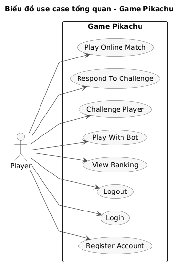
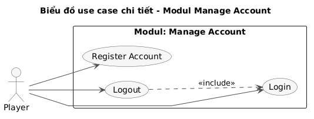
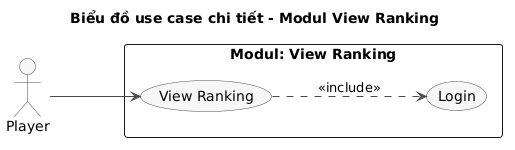
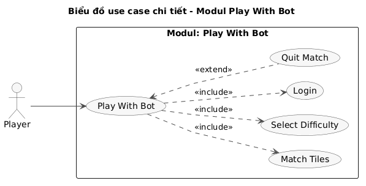
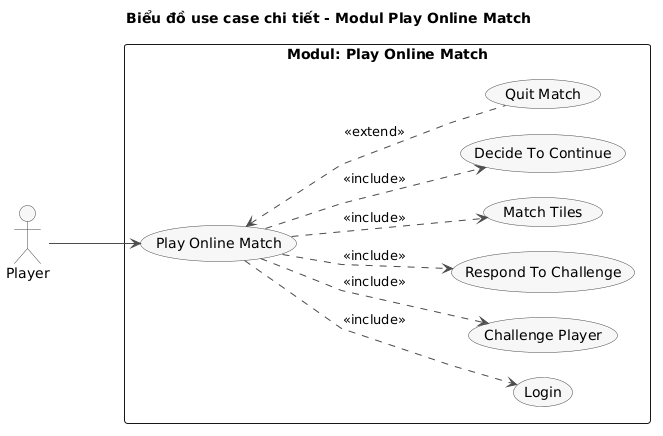

# Pha 1. Thu thập yêu cầu

## 1. Tìm hiểu lĩnh vực chuyên môn

Các từ khóa trong lĩnh vực trò chơi Pikachu đối kháng trực tuyến được gom thành ba nhóm như sau:

| Con người | Hoạt động của con người | Vật, đối tượng |
|---|---|---|
| Người chơi | Đăng ký tài khoản | Tài khoản |
| Đối thủ | Đăng nhập | Danh sách người chơi online |
| Máy | Đăng xuất | Trạng thái người chơi |
| | Xem danh sách người chơi online | Lời mời thách đấu |
| | Thách đấu | Ván đấu |
| | Chấp nhận lời mời | Đề bài |
| | Từ chối lời mời | Bàn chơi |
| | Chọn ô | Ô hình |
| | Nối cặp ô | Đường nối |
| | Thoát ván | Đồng hồ |
| | Tiếp tục chơi | Kết quả ván |
| | Chơi với máy | Điểm |
| | Chọn độ khó | Độ khó |
| | Xem bảng xếp hạng | Bảng xếp hạng |

Bảng giải thích ngữ nghĩa của từng khái niệm:

| TT | Tên tiếng Việt | Tiếng Anh | Giải thích |
|---|---|---|---|
| | **Nhóm các khái niệm liên quan đến con người** | | |
| 1 | Người chơi | Player | Người có tài khoản trong hệ thống, đăng nhập từ một máy client để chơi đối kháng với người chơi khác hoặc chơi với máy. |
| 2 | Đối thủ | Opponent | Người chơi ở phía bên kia của một ván đối kháng: người được mời khi mình thách đấu, hoặc người đã mời mình. |
| 3 | Máy | Bot | Đối thủ do hệ thống điều khiển trong chế độ chơi với máy, tự tìm và xóa các cặp ô với tốc độ theo độ khó. |
| | **Nhóm các khái niệm liên quan đến hoạt động của con người** | | |
| 4 | Đăng ký tài khoản | Register account | Người chơi nhập tên đăng nhập, mật khẩu và tên hiển thị để tạo tài khoản mới. |
| 5 | Đăng nhập | Login | Người chơi nhập tên đăng nhập và mật khẩu để hệ thống xác thực, sau đó vào giao diện chính. |
| 6 | Đăng xuất | Logout | Người chơi rời khỏi hệ thống, không còn xuất hiện trong danh sách người chơi online. |
| 7 | Thách đấu | Challenge | Người chơi click vào tên một người chơi đang rỗi trong danh sách online và xác nhận để gửi lời mời đấu một ván. |
| 8 | Trả lời lời mời | Respond to challenge | Người được mời chấp nhận (OK) hoặc từ chối (Reject) lời mời thách đấu. |
| 9 | Nối cặp ô | Match tiles | Người chơi click lần lượt hai ô có cùng hình. Nếu hai ô nối được với nhau bằng tối đa 3 đoạn thẳng chỉ đi qua ô trống thì hai ô biến mất. |
| 10 | Thoát ván | Quit match | Người chơi bấm nút thoát khi ván chưa kết thúc. Ở ván đối kháng, người thoát bị xử thua. |
| 11 | Tiếp tục chơi | Continue | Sau mỗi ván đối kháng, mỗi người chơi chọn có tiếp tục đấu ván mới với cùng đối thủ hay không. |
| 12 | Chơi với máy | Play with bot | Người chơi chọn độ khó rồi đua với máy trên cùng một đề bài. Kết quả không tính vào bảng xếp hạng. |
| 13 | Xem bảng xếp hạng | View ranking | Người chơi xem thứ hạng của toàn bộ người chơi trong hệ thống. |
| | **Nhóm các khái niệm liên quan đến vật, đối tượng xử lý** | | |
| 14 | Tài khoản | Account | Cặp tên đăng nhập và mật khẩu gắn với một người chơi. |
| 15 | Trạng thái người chơi | Player status | Tình trạng hiện tại của người chơi đang online, có ba giá trị: rỗi (idle: không chơi với ai, đang ở giao diện chính hoặc các màn hình khác), luyện tập (training: đang chơi với máy, vẫn nhận được lời mời thách đấu), bận (busy: đang đấu với người chơi khác, không nhận lời mời). |
| 16 | Lời mời thách đấu | Challenge invitation | Yêu cầu đấu một ván do một người chơi gửi tới người chơi khác, chờ người được mời trả lời. |
| 17 | Ván đấu | Match | Một lượt đấu giữa hai người chơi trên cùng một đề bài, có thời gian giới hạn 10 phút, do server làm trọng tài. |
| 18 | Đề bài | Puzzle | Cách sắp xếp các hình trên bàn chơi của một ván, do server sinh tự động và gửi giống nhau cho cả hai người chơi. |
| 19 | Bàn chơi | Board | Ma trận 10x10 ô hình mà người chơi thao tác. Mỗi loại hình xuất hiện một số chẵn lần để luôn ghép được thành cặp. |
| 20 | Ô hình | Tile | Một ô trên bàn chơi, mang hình một nhân vật Pikachu, hoặc là ô trống sau khi đã bị xóa. |
| 21 | Đường nối | Path | Đường gấp khúc gồm tối đa 3 đoạn thẳng nối hai ô cùng hình, chỉ đi qua các ô trống, có thể đi vòng ra ngoài viền bàn chơi. |
| 22 | Bế tắc | Deadlock | Trên bàn còn ô nhưng không còn cặp nào nối được. Khi đó hệ thống xáo lại các ô còn lại. |
| 23 | Kết quả ván | Match result | Thắng, hòa hoặc thua của mỗi người chơi trong một ván, kèm thời gian hoàn thành nếu người đó xóa hết ô. |
| 24 | Điểm | Point | Số điểm người chơi nhận được sau mỗi ván đối kháng theo kết quả thắng, hòa, thua; tổng điểm dùng để xếp hạng. |
| 25 | Bảng xếp hạng | Ranking | Danh sách người chơi sắp xếp lần lượt theo tổng điểm, trung bình điểm của các đối thủ đã gặp và trung bình thời gian hoàn thành các ván thắng. |

## 2. Mô tả hệ thống bằng ngôn ngữ tự nhiên

### Bước 1: Mục đích của hệ thống

Hệ thống là trò chơi Pikachu nhiều người chơi trên thiết bị Android, gồm một server và nhiều client. Người chơi có thể thách đấu nhau qua mạng, với server làm trọng tài và lưu toàn bộ thông tin, kết quả các ván đấu; hoặc chơi với máy để luyện tập. Hệ thống xếp hạng toàn bộ người chơi dựa trên kết quả các ván đối kháng.

### Bước 2: Phạm vi hệ thống

Những người được vào hệ thống và chức năng mỗi người được thực hiện:

- Người chơi chưa đăng nhập:
  - Đăng ký tài khoản
  - Đăng nhập
- Người chơi đã đăng nhập:
  - Đăng xuất
  - Xem danh sách người chơi online và thách đấu một người chơi đang rỗi
  - Trả lời lời mời thách đấu của người chơi khác
  - Chơi ván đối kháng, chọn tiếp tục hay dừng sau mỗi ván
  - Chơi với máy
  - Xem bảng xếp hạng

Những chức năng không đề cập đến thì không thuộc phạm vi của hệ thống, ví dụ: nhắn tin giữa người chơi, kết bạn, mua vật phẩm.

### Bước 3: Hoạt động nghiệp vụ của các chức năng

Mô tả chi tiết bốn chức năng được chọn làm modul phân tích, thiết kế:

- Người chơi quản lý tài khoản: Người chơi mở ứng dụng → giao diện đăng nhập hiện lên → người chơi chưa có tài khoản bấm Đăng ký → hệ thống hiện giao diện đăng ký gồm tên đăng nhập, mật khẩu, nhập lại mật khẩu, tên hiển thị → người chơi nhập và bấm Đăng ký → hệ thống kiểm tra không ô nào để trống, mật khẩu nhập lại khớp và tên đăng nhập chưa có ai dùng; nếu không hợp lệ thì báo lỗi; nếu hợp lệ thì lưu tài khoản (mật khẩu được băm, không lưu bản gốc) và đưa người chơi về giao diện đăng nhập với tên đăng nhập điền sẵn → người chơi nhập mật khẩu và bấm Đăng nhập → hệ thống kiểm tra tài khoản, từ chối nếu sai hoặc nếu tài khoản đang đăng nhập ở máy khác; nếu đúng thì đưa người chơi vào danh sách online với trạng thái rỗi và hiện giao diện chính → khi muốn thoát, người chơi bấm Đăng xuất → hệ thống xóa người chơi khỏi danh sách online, cập nhật danh sách trên máy những người chơi khác và đưa người chơi về giao diện đăng nhập.

- Người chơi xem bảng xếp hạng: Người chơi mở ứng dụng → giao diện đăng nhập hiện lên → người chơi nhập tên đăng nhập, mật khẩu và bấm Đăng nhập → hệ thống kiểm tra tài khoản, nếu đúng thì hiện giao diện chính gồm danh sách người chơi online (tên, tổng điểm, trạng thái) và các nút Xem bảng xếp hạng, Chơi với máy, Đăng xuất → người chơi bấm Xem bảng xếp hạng → hệ thống hiện bảng xếp hạng toàn bộ người chơi, sắp xếp theo tổng điểm giảm dần; nếu bằng nhau thì theo trung bình điểm của các đối thủ đã gặp giảm dần; nếu vẫn bằng nhau thì theo trung bình thời gian hoàn thành các ván thắng tăng dần → người chơi bấm Quay lại để về giao diện chính.

- Người chơi chơi với máy: Tại giao diện chính, người chơi bấm Chơi với máy → hệ thống hiện giao diện chọn độ khó (Dễ, Trung bình, Khó) → người chơi chọn độ khó và bấm Bắt đầu → hệ thống sinh một đề bài 10x10, hiện bàn chơi, đồng hồ đếm ngược 10 phút, số ô còn lại của người chơi và của máy, nút Thoát; máy bắt đầu chơi trên một bàn riêng có cùng đề bài → người chơi click lần lượt hai ô cùng hình, nếu hai ô nối được bằng tối đa 3 đoạn thẳng thì hệ thống vẽ đường nối và xóa hai ô, nếu không thì bỏ chọn; máy cũng tự xóa từng cặp sau mỗi khoảng thời gian theo độ khó; nếu bàn bị bế tắc thì hệ thống xáo lại các ô còn lại → bên nào xóa hết ô trước thì thắng; hết giờ mà chưa bên nào xong thì hòa → hệ thống hiện kết quả, người chơi bấm OK để về giao diện chính. Kết quả ván với máy không được lưu và không tính vào bảng xếp hạng.

- Người chơi thách đấu và đấu đối kháng: Tại giao diện chính, người chơi A click vào tên người chơi B đang rỗi trong danh sách online → hệ thống hiện dialog xác nhận thách đấu B với hai nút Xác nhận và Hủy, đề phòng A bấm nhầm; nếu A bấm Hủy thì quay lại giao diện chính → A bấm Xác nhận thì hệ thống gửi lời mời tới B và báo A đang chờ trả lời → trên máy của B hiện dialog lời mời với hai nút OK và Reject → nếu B bấm Reject thì hệ thống báo A bị từ chối; nếu B bấm OK thì server tạo ván đấu, sinh một đề bài, gửi cùng đề cho cả hai máy và chuyển trạng thái hai người sang bận → hai người cùng chơi trên đề bài đó trong 10 phút, mỗi lần click một cặp ô thì server kiểm tra đường nối và báo kết quả; mỗi người xóa cặp trên bàn của riêng mình; nếu bàn của một người bị bế tắc thì server xáo lại bàn đó và chỉ gửi bàn mới cho người đó → người xóa hết ô trước thắng; hết giờ mà cả hai chưa xong thì hòa; người bấm Thoát hoặc mất kết nối giữa ván bị xử thua → server lưu kết quả ván, cập nhật điểm và gửi kết quả cho cả hai → mỗi máy hiện dialog kết quả kèm câu hỏi có muốn tiếp tục không → nếu cả hai chọn tiếp tục thì bắt đầu ván mới với đề bài mới; nếu một người dừng thì cả hai về giao diện chính, server báo cho người còn lại biết đối thủ đã dừng chơi, trạng thái hai người trở về rỗi.

### Bước 4: Thông tin các đối tượng cần xử lý, quản lý

- Người chơi: tên đăng nhập, mật khẩu, tên hiển thị, trạng thái (rỗi, luyện tập, bận; người rỗi và người luyện tập đều nhận được lời mời thách đấu). Trạng thái chỉ có ý nghĩa khi người chơi đang online, không cần lưu lâu dài.
- Ván đấu: thời điểm bắt đầu, thời điểm kết thúc, thời gian giới hạn.
- Kết quả của một người chơi trong ván: kết quả (thắng, hòa, thua), điểm nhận được, thời gian hoàn thành (chỉ có khi người đó xóa hết ô), bàn chơi của người đó khi ván kết thúc.
- Bàn chơi (đề bài): số hàng, số cột, các ô hình.
- Bảng xếp hạng: với mỗi người chơi có tổng điểm, trung bình điểm của các đối thủ đã gặp, trung bình thời gian hoàn thành các ván thắng. Đây là thông tin tính ra từ kết quả các ván, không nhập trực tiếp.

### Bước 5: Quan hệ giữa các đối tượng, thông tin

- Một ván đấu có đúng hai người chơi; một người chơi tham gia nhiều ván đấu.
- Mỗi người chơi trong một ván có đúng một kết quả; một ván có đúng hai kết quả.
- Một ván đấu được chơi trên đúng một đề bài; hai người trong ván dùng chung đề bài đó.
- Mỗi người chơi trong ván xóa cặp trên bàn chơi riêng của mình, bắt đầu từ đề bài chung; mỗi kết quả gắn với đúng một bàn chơi riêng đó.
- Một ván với máy cũng dùng một đề bài nhưng không tạo ván đấu được lưu.
- Bảng xếp hạng của một người chơi được tính từ tất cả kết quả của người đó và điểm của các đối thủ trong cùng các ván.
- Tại một thời điểm, một người chơi tham gia tối đa một ván.

## 3. Mô tả hệ thống bằng ngôn ngữ UML: use case

### a. Biểu đồ use case tổng quan

Từ bước 2 của mục 2, mọi chức năng đều do người chơi thực hiện, nên hệ thống có một actor là `Player`. Người được thách đấu cũng là một `Player`, thao tác trực tiếp trên máy của mình để trả lời lời mời, nên không cần actor riêng. Máy (bot) là một phần của hệ thống, không phải actor.

Mỗi chức năng ở bước 2 được đề xuất thành một use case. Sau khi mịn hóa:

- Thách đấu, trả lời lời mời và chơi ván là các bước của cùng một phiên đấu đối kháng giữa hai người chơi: người thách đấu gửi lời mời, người được mời trả lời, rồi cả hai cùng chơi. Vì vậy chức năng này là một use case chính `Play Online Match` có cả hai người chơi tham gia, include `Challenge Player` (phần của người thách đấu) và `Respond To Challenge` (phần của người được mời). Mỗi lần thực hiện gồm đúng một lời mời và một lần trả lời: bị từ chối thì dừng sớm, cả hai chọn tiếp tục thì đấu thêm ván mà không mời lại.
- Xem danh sách người chơi online không tách thành use case riêng vì đây là giao diện chính sau khi đăng nhập, dùng để chọn đối thủ trong `Challenge Player`.

Biểu đồ use case tổng quan như Hình 1.1.

*Hình 1.1: Biểu đồ use case tổng quan*

| STT | Use case | Mô tả |
|---|---|---|
| 1 | `Register Account` | Cho phép người chơi tạo tài khoản mới |
| 2 | `Login` | Cho phép người chơi đăng nhập bằng tên đăng nhập và mật khẩu |
| 3 | `Logout` | Cho phép người chơi đăng xuất khỏi hệ thống |
| 4 | `View Ranking` | Cho phép người chơi xem bảng xếp hạng toàn bộ người chơi |
| 5 | `Play With Bot` | Cho phép người chơi chọn độ khó và chơi một ván với máy |
| 6 | `Play Online Match` | Cho phép hai người chơi thách đấu nhau và đấu đối kháng trên cùng đề bài, server làm trọng tài |
| 7 | `Challenge Player` | Cho phép người chơi chọn một người chơi đang rỗi, xác nhận và gửi lời mời đấu |
| 8 | `Respond To Challenge` | Cho phép người được mời chấp nhận hoặc từ chối lời mời thách đấu |

### b. Use case chi tiết cho modul quản lý tài khoản

Trong chức năng quản lý tài khoản, người chơi tương tác với các giao diện:

- Giao diện đăng ký, nơi người chơi nhập thông tin tài khoản mới → thống nhất với UC `Register Account`.
- Giao diện đăng nhập → thống nhất với UC `Login`.
- Nút Đăng xuất trên giao diện chính → thống nhất với UC `Logout`.
- Ba use case đều có sẵn trong biểu đồ tổng quan và người chơi dùng trực tiếp cả ba, nên giữ nguyên ba use case nối thẳng với `Player`. Không gộp thành một use case chung vì ba việc có mục đích riêng và không bắt buộc đi cùng nhau: người đã có tài khoản không cần đăng ký.
- Phải đăng nhập mới đăng xuất được, do đó `Logout` include `Login`, giống `View Ranking` include `Login`.
- Đăng ký không cần đăng nhập. Đăng ký xong thì người chơi được đưa về giao diện đăng nhập; đây là chuyển giao diện, không phải quan hệ giữa hai use case.

Biểu đồ use case chi tiết như Hình 1.2.

*Hình 1.2: Biểu đồ use case chi tiết cho modul quản lý tài khoản*

| Use case | Mô tả |
|---|---|
| `Register Account` | Cho phép người chơi tạo tài khoản mới với tên đăng nhập chưa ai dùng, mật khẩu và tên hiển thị |
| `Login` | Cho phép người chơi đăng nhập bằng tên đăng nhập và mật khẩu; một tài khoản chỉ đăng nhập ở một máy tại một thời điểm |
| `Logout` | Cho phép người chơi đăng xuất, rời khỏi danh sách người chơi online |

### c. Use case chi tiết cho modul xem bảng xếp hạng

Trong chức năng xem bảng xếp hạng, người chơi tương tác với các giao diện:

- Giao diện đăng nhập → thống nhất với UC `Login`.
- Giao diện chính có nút Xem bảng xếp hạng, và giao diện bảng xếp hạng → chính là UC `View Ranking`.
- Phải đăng nhập mới xem được bảng xếp hạng, do đó UC `View Ranking` include UC `Login`.

Biểu đồ use case chi tiết như Hình 1.3.

*Hình 1.3: Biểu đồ use case chi tiết cho modul xem bảng xếp hạng*

| Use case | Mô tả |
|---|---|
| `View Ranking` | Cho phép người chơi xem bảng xếp hạng toàn bộ người chơi theo ba tiêu chí |
| `Login` | Cho phép người chơi đăng nhập trước khi xem bảng xếp hạng |

### d. Use case chi tiết cho modul chơi với máy

Trong chức năng chơi với máy, người chơi tương tác với các giao diện:

- Giao diện đăng nhập → thống nhất với UC `Login`.
- Giao diện chọn độ khó → đề xuất UC `Select Difficulty`.
- Giao diện bàn chơi, nơi người chơi click các cặp ô → đề xuất UC `Match Tiles`.
- Nút Thoát trên bàn chơi → đề xuất UC `Quit Match`.
- Đăng nhập, chọn độ khó và nối cặp ô đều bắt buộc để hoàn thành một ván, do đó UC `Play With Bot` include ba UC này.
- Thoát ván chỉ xảy ra khi người chơi muốn bỏ dở, không phải luồng bắt buộc, và có thể xảy ra ngay khi bàn chơi vừa hiện, trước khi nối cặp nào, do đó UC `Quit Match` extend UC `Play With Bot`.
- Dialog kết quả cuối ván chỉ hiện kết quả và có nút OK, không phải một tương tác riêng nên không tách thành UC.

Biểu đồ use case chi tiết như Hình 1.4.

*Hình 1.4: Biểu đồ use case chi tiết cho modul chơi với máy*

| Use case | Mô tả |
|---|---|
| `Play With Bot` | Cho phép người chơi đấu một ván với máy trên cùng một đề bài |
| `Login` | Cho phép người chơi đăng nhập trước khi chơi |
| `Select Difficulty` | Cho phép người chơi chọn độ khó của máy: Dễ, Trung bình, Khó |
| `Match Tiles` | Cho phép người chơi click lần lượt hai ô cùng hình để xóa chúng nếu nối được bằng tối đa 3 đoạn thẳng |
| `Quit Match` | Cho phép người chơi bỏ dở ván đang chơi |

### e. Use case chi tiết cho modul thách đấu và đấu đối kháng

Trong chức năng thách đấu, hai người chơi tương tác với các giao diện:

- Giao diện đăng nhập → thống nhất với UC `Login`.
- Danh sách người chơi online trên giao diện chính, nơi người chơi click tên đối thủ, và dialog xác nhận thách đấu ngay sau đó → thống nhất với UC `Challenge Player`. Chọn đối thủ và xác nhận là toàn bộ việc thách đấu, nên không tách thêm UC chọn đối thủ; dialog xác nhận chỉ để chống bấm nhầm.
- Dialog lời mời trên máy người được mời → thống nhất với UC `Respond To Challenge`.
- Giao diện bàn chơi → đề xuất UC `Match Tiles`; nút Thoát → đề xuất UC `Quit Match`.
- Dialog kết quả hỏi có muốn tiếp tục không → đề xuất UC `Decide To Continue`.
- Mỗi phiên đấu luôn cần hai người chơi đã đăng nhập, một lời mời, một lần trả lời, các lượt nối cặp ô và lựa chọn tiếp tục hay dừng ở cuối mỗi ván, do đó `Play Online Match` include `Login`, `Challenge Player`, `Respond To Challenge`, `Match Tiles` và `Decide To Continue`.
- Thoát giữa ván không bắt buộc và có thể xảy ra bất cứ lúc nào trong ván, kể cả trước khi nối cặp nào, do đó `Quit Match` extend `Play Online Match`.
- `Match Tiles` và `Quit Match` dùng chung với modul chơi với máy.

Biểu đồ use case chi tiết như Hình 1.5.

*Hình 1.5: Biểu đồ use case chi tiết cho modul thách đấu và đấu đối kháng*

| Use case | Mô tả |
|---|---|
| `Play Online Match` | Cho phép hai người chơi thách đấu nhau và đấu một phiên đối kháng trên cùng đề bài, server làm trọng tài, lưu kết quả và cập nhật điểm |
| `Login` | Cho phép người chơi đăng nhập trước khi thách đấu hoặc nhận lời mời |
| `Challenge Player` | Cho phép người chơi chọn một đối thủ đang rỗi trong danh sách người chơi online, xác nhận rồi gửi lời mời |
| `Respond To Challenge` | Cho phép người được mời chấp nhận hoặc từ chối lời mời |
| `Match Tiles` | Cho phép người chơi click lần lượt hai ô cùng hình để xóa chúng nếu nối được bằng tối đa 3 đoạn thẳng |
| `Decide To Continue` | Cho phép mỗi người chơi chọn tiếp tục ván mới hoặc dừng sau khi một ván kết thúc |
| `Quit Match` | Cho phép người chơi bỏ dở ván, người thoát bị xử thua |
