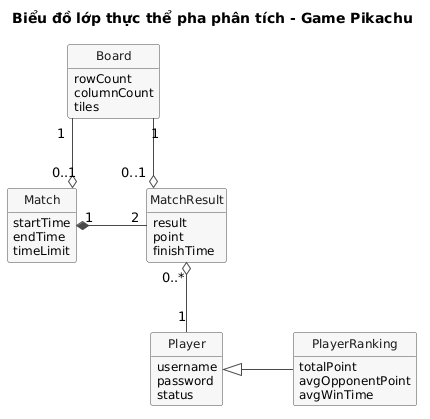
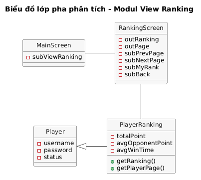
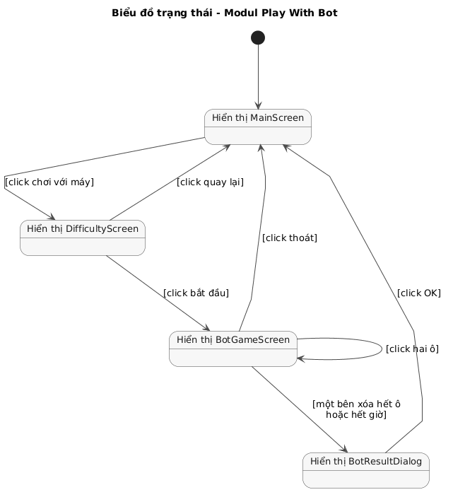

# Pha 2. Phân tích

## 1. Kịch bản cho ba modul

Dữ liệu mẫu dùng chung: người chơi Hoàng Nam (tên đăng nhập `hoangnam`) là người thao tác chính; Minh Anh (`minhanh`) là đối thủ ở modul thách đấu.

### a. Kịch bản cho modul xem bảng xếp hạng

| Trường | Nội dung |
|---|---|
| **Use case** | `View Ranking`: Xem bảng xếp hạng |
| **Actor** | Player (Người chơi) |
| **Tiền điều kiện** | Người chơi đã có tài khoản và đang ở giao diện đăng nhập của ứng dụng |
| **Hậu điều kiện** | Người chơi xem được bảng xếp hạng và quay về giao diện chính |
| **Kịch bản chuẩn** | 1. Tại giao diện đăng nhập, Hoàng Nam nhập tên đăng nhập `hoangnam`, mật khẩu và click nút **Đăng nhập**. 2. Hệ thống kiểm tra tài khoản hợp lệ, hiện giao diện chính gồm danh sách người chơi online và các nút **Xem bảng xếp hạng**, **Chơi với máy**, **Đăng xuất**:<table><tr><th>TT</th><th>Tên</th><th>Tổng điểm</th><th>Trạng thái</th></tr><tr><td>1</td><td>Minh Anh</td><td>12.5</td><td>Rỗi</td></tr><tr><td>2</td><td>Quốc Bảo</td><td>10.5</td><td>Bận</td></tr><tr><td>3</td><td>Thu Hà</td><td>7.5</td><td>Rỗi</td></tr></table> 3. Hoàng Nam click nút **Xem bảng xếp hạng**. 4. Giao diện bảng xếp hạng hiện lên, sắp xếp theo tổng điểm giảm dần, rồi trung bình điểm đối thủ giảm dần, rồi trung bình thời gian thắng tăng dần; có nút **Quay lại**:<table><tr><th>Hạng</th><th>Tên</th><th>Tổng điểm</th><th>TB điểm đối thủ</th><th>TB thời gian thắng</th></tr><tr><td>1</td><td>Minh Anh</td><td>12.5</td><td>9.2</td><td>05:48</td></tr><tr><td>2</td><td>Hoàng Nam</td><td>11</td><td>10.1</td><td>06:10</td></tr><tr><td>3</td><td>Quốc Bảo</td><td>10.5</td><td>9.5</td><td>06:31</td></tr><tr><td>4</td><td>Thu Hà</td><td>7.5</td><td>11.0</td><td>07:02</td></tr><tr><td>5</td><td>Đức Long</td><td>7.5</td><td>8.4</td><td>06:55</td></tr></table> 5. Hoàng Nam click nút **Quay lại**. 6. Hệ thống đưa Hoàng Nam về giao diện chính. |
| **Ngoại lệ** | 2a. Tên đăng nhập hoặc mật khẩu không đúng. 2b. Tài khoản đang được đăng nhập trên một máy khác. 4a. Hệ thống chưa có ván đối kháng nào nên bảng xếp hạng rỗng. |

### b. Kịch bản cho modul chơi với máy

| Trường | Nội dung |
|---|---|
| **Use case** | `Play With Bot`: Chơi với máy |
| **Actor** | Player (Người chơi) |
| **Tiền điều kiện** | Người chơi đã đăng nhập và đang ở giao diện chính |
| **Hậu điều kiện** | Ván với máy kết thúc, người chơi quay về giao diện chính; kết quả ván không được lưu và không tính vào bảng xếp hạng |
| **Kịch bản chuẩn** | 1. Tại giao diện chính, Hoàng Nam click nút **Chơi với máy**. 2. Giao diện chọn độ khó hiện lên, có ba lựa chọn **Dễ**, **Trung bình**, **Khó**, nút **Bắt đầu** và nút **Quay lại**. 3. Hoàng Nam chọn **Trung bình** và click **Bắt đầu**. 4. Hệ thống sinh một đề bài 10x10, hiện giao diện chơi gồm bàn chơi, đồng hồ đếm ngược 10:00, số ô còn lại "Bạn: 100", "Máy: 100" và nút **Thoát**; máy bắt đầu chơi trên một bàn riêng có cùng đề bài. 5. Hoàng Nam click lần lượt hai ô cùng hình. 6. Hệ thống kiểm tra hai ô nối được bằng tối đa 3 đoạn thẳng, vẽ đường nối, xóa hai ô và cập nhật "Bạn: 98". (Lặp lại bước 5-6; trong lúc đó máy tự xóa một cặp sau mỗi khoảng 4 giây và hệ thống cập nhật số ô còn lại của máy.) 7. Hoàng Nam click cặp ô cuối cùng. 8. Hệ thống xóa cặp ô, dừng đồng hồ và hiện dialog kết quả "Bạn thắng. Thời gian hoàn thành 07:15. Máy còn 12 ô." với nút **OK**. 9. Hoàng Nam click **OK**. 10. Hệ thống đưa Hoàng Nam về giao diện chính. |
| **Ngoại lệ** | 4a. Hoàng Nam click **Thoát** khi ván đang diễn ra, kể cả trước khi nối cặp nào. 6a. Hai ô không cùng hình hoặc không nối được bằng tối đa 3 đoạn thẳng. 6b. Bàn chơi bị bế tắc, không còn cặp nào nối được. 8a. Máy xóa hết ô trước Hoàng Nam. 8b. Hết 10 phút mà cả hai bên chưa xóa hết ô. |

### c. Kịch bản cho modul thách đấu và đấu đối kháng

| Trường | Nội dung |
|---|---|
| **Use case** | `Challenge Player`: Thách đấu và đấu đối kháng |
| **Actor** | Player: Hoàng Nam là người thách đấu, Minh Anh là người được mời |
| **Tiền điều kiện** | Cả hai người chơi đã đăng nhập trên hai máy client và đang ở trạng thái rỗi |
| **Hậu điều kiện** | Kết quả ván và điểm của hai người chơi được lưu trên server; hai người chơi về giao diện chính ở trạng thái rỗi |
| **Kịch bản chuẩn** | 1. Tại giao diện chính, Hoàng Nam click vào tên Minh Anh (đang rỗi) trong danh sách người chơi online. 2. Hệ thống hiện dialog xác nhận "Bạn muốn thách đấu Minh Anh?" với hai nút **Xác nhận** và **Hủy** trên máy của Hoàng Nam. 3. Hoàng Nam click **Xác nhận**. 4. Hệ thống gửi lời mời tới Minh Anh và hiện thông báo "Đang chờ Minh Anh trả lời..." trên máy của Hoàng Nam; trên máy của Minh Anh hiện dialog "Hoàng Nam muốn thách đấu bạn" với hai nút **OK** và **Reject**. 5. Minh Anh click **OK**. 6. Hệ thống tạo ván đấu, sinh một đề bài 10x10, chuyển trạng thái hai người sang bận và hiện giao diện chơi trên cả hai máy: bàn chơi với cùng đề bài, đồng hồ đếm ngược 10:00, số ô còn lại của đối thủ "Đối thủ: 100", nút **Thoát**. 7. Hoàng Nam click lần lượt hai ô cùng hình. 8. Hệ thống kiểm tra hai ô nối được bằng tối đa 3 đoạn thẳng, vẽ đường nối, xóa hai ô trên máy của Hoàng Nam và cập nhật "Đối thủ: 98" trên máy của Minh Anh. (Lặp lại bước 7-8; Minh Anh chơi song song trên máy của mình theo cùng cách.) 9. Hoàng Nam click cặp ô cuối cùng. 10. Hệ thống xóa cặp ô, ghi nhận Hoàng Nam hoàn thành lúc 06:42, kết thúc ván, lưu kết quả, cập nhật điểm và hiện dialog kết quả trên hai máy: máy của Hoàng Nam "Bạn thắng. Thời gian hoàn thành 06:42.", máy của Minh Anh "Bạn thua. Bạn còn 18 ô."; kèm câu hỏi "Bạn có muốn tiếp tục không?" với hai nút **Tiếp tục** và **Dừng**. 11. Hoàng Nam click **Dừng**. 12. Hệ thống chuyển hai người chơi về trạng thái rỗi, đưa cả hai về giao diện chính với danh sách người chơi online đã cập nhật điểm, và báo Minh Anh "Hoàng Nam đã dừng chơi". |
| **Ngoại lệ** | 4a. Hoàng Nam click **Hủy**: hệ thống đóng dialog, không gửi lời mời, Hoàng Nam ở lại giao diện chính. 4b. Minh Anh vừa chuyển sang trạng thái bận trước khi lời mời tới. 6a. Minh Anh click **Reject**. 6b. Một người chơi click **Thoát** khi ván đang diễn ra, kể cả trước khi nối cặp nào, hoặc mất kết nối giữa ván. 8a. Hai ô không cùng hình hoặc không nối được bằng tối đa 3 đoạn thẳng. 8b. Bàn chơi bị bế tắc, không còn cặp nào nối được. 10a. Minh Anh xóa hết ô trước Hoàng Nam. 10b. Hết 10 phút mà cả hai người chơi chưa xóa hết ô.  **12a. Cả hai người chơi click Tiếp tục.** 12a1. Hệ thống tạo ván mới với đề bài mới và hiện giao diện chơi trên cả hai máy như bước 6. |

## 2. Biểu đồ lớp thực thể của hệ thống

### a. Bước 1: Mô tả hệ thống trong một đoạn văn

Hệ thống là trò chơi Pikachu nhiều người chơi trên thiết bị Android, gồm một server và nhiều client. Người chơi đăng ký tài khoản gồm tên đăng nhập, mật khẩu và tên hiển thị, rồi đăng nhập từ một máy client. Sau khi đăng nhập, người chơi xem danh sách người chơi đang online với tên, tổng điểm và trạng thái rỗi, luyện tập hoặc bận; có thể thách đấu một người chơi không bận. Người được mời chấp nhận hoặc từ chối lời mời. Khi chấp nhận, server tạo một ván đấu, sinh một đề bài là bàn chơi 10x10 ô hình và gửi cho cả hai người chơi. Mỗi người chơi xóa các cặp ô cùng hình nối được bằng tối đa 3 đoạn thẳng trên bàn chơi của riêng mình, bắt đầu từ cùng đề bài; ai xóa hết ô trước thì thắng, hết giờ mà chưa ai xong thì hòa. Server lưu kết quả của từng người trong ván gồm thắng, hòa hay thua, điểm nhận được và thời gian hoàn thành, rồi hỏi hai người có muốn tiếp tục không. Người chơi cũng có thể chơi với máy theo độ khó đã chọn trên một đề bài do hệ thống sinh, kết quả không được lưu. Người chơi xem bảng xếp hạng của toàn bộ người chơi theo tổng điểm, trung bình điểm của các đối thủ đã gặp và trung bình thời gian hoàn thành các ván thắng.

### b. Bước 2: Trích các danh từ xuất hiện trong đoạn văn

- Các danh từ liên quan đến người: người chơi, đối thủ, máy.
- Các danh từ liên quan đến vật: thiết bị Android, server, client, bàn chơi, ô hình.
- Các danh từ liên quan đến thông tin: tài khoản, tên đăng nhập, mật khẩu, tên hiển thị, danh sách người chơi online, tổng điểm, trạng thái, lời mời, ván đấu, đề bài, đường nối, kết quả, điểm, thời gian hoàn thành, độ khó, bảng xếp hạng, trung bình điểm đối thủ, trung bình thời gian thắng.

### c. Bước 3: Đánh giá và lựa chọn các danh từ làm lớp thực thể hoặc thuộc tính

- Các danh từ trừu tượng hoặc thuộc về hạ tầng: hệ thống, thiết bị Android, server, client → **loại**.
- Người chơi → lớp `Player`: tên đăng nhập, tên hiển thị, mật khẩu, trạng thái. *Tài khoản* không tách thành lớp riêng vì mỗi người chơi có đúng một tài khoản. *Trạng thái* (rỗi, luyện tập, bận) chỉ có ý nghĩa khi người chơi đang online, nhưng vẫn là thông tin của người chơi nên đặt làm thuộc tính.
- *Đối thủ* là vai trò của một người chơi trong ván, không đề xuất lớp. *Máy* là một phần xử lý của hệ thống, không có dữ liệu cần quản lý nên không đề xuất lớp; *độ khó* chỉ là lựa chọn của người chơi cho ván với máy.
- Ván đấu → lớp `Match`: thời điểm bắt đầu, thời điểm kết thúc, thời gian giới hạn.
- Kết quả → lớp `MatchResult`: kết quả (thắng, hòa, thua), điểm nhận được, thời gian hoàn thành. Kết quả tách thành lớp riêng thay vì đặt trên `Match` vì mỗi ván có hai người chơi, mỗi người một kết quả, một số điểm và một thời gian hoàn thành riêng.
- Đề bài, bàn chơi → lớp `Board`: số hàng, số cột, các ô hình. Đề bài và bàn chơi riêng của mỗi người có cùng cấu trúc nên dùng chung một lớp: đề bài là bàn lúc bắt đầu ván, bàn chơi riêng là bản của từng người, khác nhau ngay sau nước đi đầu tiên. *Ô hình* là phần tử của bàn chơi nên là thuộc tính `tiles` của `Board`. *Đường nối* được tính ra mỗi lần người chơi chọn hai ô, không lưu nên không đề xuất lớp.
- *Lời mời* chỉ tồn tại trong lúc chờ người được mời trả lời, không cần lưu, nên không đề xuất lớp.
- *Danh sách người chơi online* là tập các `Player` đang online, không đề xuất lớp.
- *Tổng điểm*, *trung bình điểm đối thủ*, *trung bình thời gian thắng* là thông tin dẫn xuất của một người chơi, tính ra từ các kết quả ván, nên đề xuất lớp thống kê `PlayerRanking` kế thừa `Player`, thêm ba thuộc tính: tổng điểm, trung bình điểm đối thủ, trung bình thời gian thắng.

### d. Bước 4: Quan hệ số lượng giữa các thực thể

- Một người chơi có nhiều kết quả ở các ván khác nhau, mỗi kết quả thuộc đúng một người chơi → `Player` - `MatchResult` là 1-n.
- Một ván có đúng hai kết quả, mỗi kết quả thuộc đúng một ván → `Match` - `MatchResult` là 1-2. Hai quan hệ này đồng thời tách quan hệ n-n giữa `Player` và `Match`: `MatchResult` là lớp trung gian xác định một người chơi trong một ván.
- Một ván đấu dùng đúng một đề bài; một đề bài thuộc tối đa một ván đấu được lưu, vì đề bài của ván với máy không gắn với ván nào → `Board` - `Match` là 1-0..1.
- Mỗi kết quả gắn với đúng một bàn chơi riêng của người chơi đó trong ván; một bàn chơi thuộc tối đa một kết quả, vì đề bài của ván và bàn của ván với máy không phải bàn của kết quả nào → `Board` - `MatchResult` là 1-0..1.

### e. Bước 5: Quan hệ đối tượng giữa các thực thể

- Gắn chặt (composition): `Match` ◆ `MatchResult`. Kết quả chỉ sinh ra cùng với ván đấu và không có ý nghĩa nếu ván bị xóa.
- Hợp thành (aggregation):
  - `MatchResult` ◇ `Player`: kết quả được ghép từ người chơi, nhưng người chơi tồn tại độc lập với từng ván.
  - `Match` ◇ `Board`: ván đấu được chơi trên một đề bài, nhưng đề bài cũng được dùng ở ván với máy mà không có ván đấu nào.
  - `MatchResult` ◇ `Board`: kết quả của một người được ghép với bàn chơi riêng của người đó, vì mỗi người xóa cặp trên bản riêng và server chỉ xáo bàn của người bị bế tắc, nên hai bàn trong cùng ván khác nhau. Số ô còn lại báo trong kết quả (ví dụ "Bạn còn 18 ô") lấy từ bàn này.
- Kế thừa: `PlayerRanking` ▷ `Player`. Mỗi dòng của bảng xếp hạng là một người chơi kèm ba chỉ số thống kê, nên `PlayerRanking` thừa hưởng thông tin người chơi (tên hiển thị để hiện trên bảng) và chỉ thêm ba thuộc tính thống kê. Đây là cách giáo trình dùng cho lớp thống kê (lớp thống kê kế thừa lớp thực thể được thống kê). Ba thuộc tính này vẫn tính ra từ các `MatchResult` của người chơi và của các đối thủ trong cùng ván, không nhập trực tiếp.

Kết quả thu được biểu đồ lớp thực thể pha phân tích của toàn hệ thống như Hình 2.1.

*Hình 2.1: Biểu đồ lớp thực thể của hệ thống*

| Lớp | Thuộc tính |
|---|---|
| `Player` | username, password, name, status (rỗi/idle, luyện tập/training, bận/busy) |
| `Match` | startTime, endTime, timeLimit |
| `MatchResult` | result (thắng, hòa, thua), point, finishTime (rỗng nếu chưa xóa hết ô) |
| `Board` | rowCount, columnCount, tiles |
| `PlayerRanking` (kế thừa `Player`) | totalPoint, avgOpponentPoint, avgWinTime |

## 3. Biểu đồ lớp pha phân tích cho ba modul

### a. Phân tích tĩnh modul xem bảng xếp hạng

- Bước 1 của kịch bản, giao diện đăng nhập đề xuất lớp `LoginScreen`, cần có: ô nhập tên đăng nhập và mật khẩu, kiểu input; ô thông báo lỗi, kiểu output; nút đăng nhập, kiểu submit.
- Để đăng nhập, cần xử lý dưới hệ thống: kiểm tra tài khoản. Input: tên đăng nhập, mật khẩu. Output: người chơi tương ứng hoặc rỗng. Đầu ra là lớp `Player` nên đề xuất phương thức `checkLogin()`, gán cho lớp `Player`.
- Bước 2, giao diện chính đề xuất lớp `MainScreen`, trong modul này chỉ cần nút xem bảng xếp hạng, kiểu submit.
- Bước 4, giao diện bảng xếp hạng đề xuất lớp `RankingScreen`, cần có: bảng xếp hạng, kiểu output; nút quay lại, kiểu submit.
- Để có bảng xếp hạng, cần xử lý dưới hệ thống: tính ba chỉ số của mọi người chơi và sắp xếp. Input: không có. Output: danh sách `PlayerRanking` đã sắp xếp. Đầu ra là lớp `PlayerRanking` nên đề xuất phương thức `getRanking()`, gán cho lớp `PlayerRanking`.

Biểu đồ lớp pha phân tích của modul như Hình 2.2.

*Hình 2.2: Biểu đồ lớp pha phân tích cho modul xem bảng xếp hạng*

| Phương thức | Input | Output | Gán cho lớp |
|---|---|---|---|
| `checkLogin()` | tên đăng nhập, mật khẩu | người chơi hoặc rỗng | `Player` |
| `getRanking()` | không có | danh sách `PlayerRanking` đã sắp xếp | `PlayerRanking` |

### b. Phân tích tĩnh modul chơi với máy

- Giao diện chính đề xuất lớp `MainScreen`, trong modul này cần nút chơi với máy, kiểu submit.
- Bước 2, giao diện chọn độ khó đề xuất lớp `DifficultyScreen`, cần có: ô chọn độ khó, kiểu input; nút bắt đầu và nút quay lại, kiểu submit.
- Để bắt đầu ván, cần xử lý dưới hệ thống: sinh đề bài. Input: số hàng, số cột. Output: một bàn chơi. Đầu ra là lớp `Board` nên đề xuất phương thức `generateBoard()`, gán cho lớp `Board`.
- Bước 4, giao diện chơi đề xuất lớp `BotGameScreen`, cần có: bàn chơi, đồng hồ, số ô còn lại của người chơi và của máy, kiểu output; ô người chơi click, kiểu input; nút thoát, kiểu submit.
- Khi người chơi chọn hai ô, cần xử lý dưới hệ thống, đều có input là bàn chơi và hai ô, đều liên quan tới lớp `Board`:
  - kiểm tra hai ô nối được bằng tối đa 3 đoạn thẳng, output là đường nối hoặc rỗng → `checkPath()`;
  - xóa hai ô, output là bàn chơi mới → `removePair()`;
  - kiểm tra bàn đã hết ô chưa, output đúng hoặc sai → `isCleared()`.
- Máy chơi và việc phát hiện bế tắc cần: tìm một cặp ô còn nối được trên bàn, output là cặp ô hoặc rỗng → `findAvailablePair()`; xáo lại các ô còn lại khi bế tắc → `shuffle()`. Cả hai gán cho lớp `Board`.
- Bước 8, dialog kết quả đề xuất lớp `BotResultDialog`, cần có: kết quả, kiểu output; nút OK, kiểu submit.

Biểu đồ lớp pha phân tích của modul như Hình 2.3.

*Hình 2.3: Biểu đồ lớp pha phân tích cho modul chơi với máy*

| Phương thức | Input | Output | Gán cho lớp |
|---|---|---|---|
| `generateBoard()` | số hàng, số cột | bàn chơi | `Board` |
| `checkPath()` | bàn chơi, hai ô | đường nối hoặc rỗng | `Board` |
| `removePair()` | bàn chơi, hai ô | bàn chơi mới | `Board` |
| `isCleared()` | bàn chơi | đúng hoặc sai | `Board` |
| `findAvailablePair()` | bàn chơi | một cặp ô nối được hoặc rỗng | `Board` |
| `shuffle()` | bàn chơi | bàn chơi đã xáo | `Board` |

### c. Phân tích tĩnh modul thách đấu và đấu đối kháng

- Giao diện chính đề xuất lớp `MainScreen`, cần có: danh sách người chơi online, kiểu output; thông báo (đang chờ, bị từ chối, đối thủ đã dừng), kiểu output; tên đối thủ để click, kiểu submit.
- Để hiện danh sách online, cần: lấy các người chơi đang online, output là danh sách `Player` → `getOnlinePlayers()`, gán cho `Player`; lấy tổng điểm của các người chơi đó, output là các `PlayerRanking` → `getTotalPoints()`, gán cho `PlayerRanking`.
- Bước 2, dialog xác nhận thách đấu trên máy người thách đấu đề xuất lớp `ChallengeConfirmDialog`, cần có: tên đối thủ, kiểu output; nút Xác nhận và nút Hủy, kiểu submit.
- Bước 3, khi click Xác nhận, cần: gửi lời mời, input là người mời và người được mời, đều là `Player` → `sendInvitation()`, gán cho `Player`.
- Bước 4, dialog lời mời trên máy người được mời đề xuất lớp `InvitationDialog`, cần có: tên người mời, kiểu output; nút OK và nút Reject, kiểu submit.
- Bước 6, khi người được mời chấp nhận, cần: sinh đề bài → `Board.generateBoard()`; tạo ván đấu cho hai người với đề bài vừa sinh, output là `Match` → `createMatch()`, gán cho `Match`; chuyển trạng thái hai người sang bận, input là các `Player` → `updateStatus()`, gán cho `Player`.
- Bước 6, giao diện chơi đề xuất lớp `MatchScreen`, cần có: bàn chơi, đồng hồ, số ô còn lại của đối thủ, kiểu output; ô người chơi click, kiểu input; nút thoát, kiểu submit. Các xử lý khi chọn hai ô dùng lại `checkPath()`, `removePair()`, `isCleared()`, `findAvailablePair()`, `shuffle()` của `Board`.
- Bước 10, khi ván kết thúc, cần: lưu ván cùng hai kết quả và điểm, input là ván và kết quả của hai người → `saveMatch()`, gán cho `Match` vì `Match` gắn chặt với hai `MatchResult`.
- Bước 10, dialog kết quả đề xuất lớp `ResultDialog`, cần có: kết quả, kiểu output; nút tiếp tục và nút dừng, kiểu submit. Khi dừng, chuyển trạng thái hai người về rỗi bằng `Player.updateStatus()`.

Biểu đồ lớp pha phân tích của modul như Hình 2.4.

*Hình 2.4: Biểu đồ lớp pha phân tích cho modul thách đấu và đấu đối kháng*

| Phương thức | Input | Output | Gán cho lớp |
|---|---|---|---|
| `getOnlinePlayers()` | không có | danh sách `Player` đang online | `Player` |
| `sendInvitation()` | người mời, người được mời | gửi được hay không | `Player` |
| `updateStatus()` | danh sách người chơi, trạng thái mới | thành công hay không | `Player` |
| `getTotalPoints()` | danh sách người chơi | các `PlayerRanking` tương ứng | `PlayerRanking` |
| `createMatch()` | hai người chơi, đề bài | `Match` | `Match` |
| `saveMatch()` | ván đấu, kết quả của hai người | thành công hay không | `Match` |
| `generateBoard()`, `checkPath()`, `removePair()`, `isCleared()`, `findAvailablePair()`, `shuffle()` | như modul chơi với máy | như modul chơi với máy | `Board` |

## 4. Biểu đồ trạng thái cho ba modul

### a. Biểu đồ trạng thái modul xem bảng xếp hạng

- Từ giao diện đăng nhập, nếu click đăng nhập mà sai tài khoản thì hệ thống hiện lại giao diện đăng nhập kèm thông báo; nếu đúng thì chuyển sang giao diện chính.
- Từ giao diện chính, khi click xem bảng xếp hạng thì hệ thống chuyển sang giao diện bảng xếp hạng.
- Từ giao diện bảng xếp hạng, khi click quay lại thì hệ thống trở về giao diện chính.

*Hình 2.5: Biểu đồ trạng thái của modul xem bảng xếp hạng*

### b. Biểu đồ trạng thái modul chơi với máy

- Từ giao diện chính, khi click chơi với máy thì hệ thống chuyển sang giao diện chọn độ khó.
- Từ giao diện chọn độ khó, khi click quay lại thì trở về giao diện chính; khi click bắt đầu thì chuyển sang giao diện chơi.
- Tại giao diện chơi, mỗi lần click hai ô thì hệ thống hiện lại chính giao diện đó với bàn chơi mới; khi click thoát thì trở về giao diện chính; khi một bên xóa hết ô hoặc hết giờ thì chuyển sang dialog kết quả.
- Từ dialog kết quả, khi click OK thì trở về giao diện chính.

*Hình 2.6: Biểu đồ trạng thái của modul chơi với máy*

### c. Biểu đồ trạng thái modul thách đấu và đấu đối kháng

- Tại giao diện chính, khi click tên một đối thủ rỗi thì hệ thống hiện dialog xác nhận thách đấu. Từ dialog xác nhận, click hủy thì trở về giao diện chính; click xác nhận thì trở về giao diện chính kèm thông báo đang chờ; nếu đối thủ từ chối thì hiện lại kèm thông báo bị từ chối; nếu đối thủ chấp nhận thì chuyển sang giao diện chơi.
- Tại giao diện chính, khi nhận lời mời thì hệ thống hiện dialog lời mời. Từ dialog lời mời, click reject thì trở về giao diện chính, click OK thì chuyển sang giao diện chơi.
- Tại giao diện chơi, mỗi lần click hai ô thì hệ thống hiện lại chính giao diện đó; khi click thoát thì trở về giao diện chính; khi một bên xóa hết ô, hết giờ hoặc đối thủ thoát thì chuyển sang dialog kết quả.
- Từ dialog kết quả, nếu cả hai click tiếp tục thì chuyển sang giao diện chơi của ván mới; nếu mình click dừng hoặc đối thủ dừng thì trở về giao diện chính.

*Hình 2.7: Biểu đồ trạng thái của modul thách đấu và đấu đối kháng*

## 5. Kịch bản chi tiết phiên bản 2 cho ba modul

### a. Kịch bản phiên bản 2 cho modul xem bảng xếp hạng

1. Tại giao diện đăng nhập, người chơi nhập tên đăng nhập, mật khẩu và click nút Đăng nhập.
2. Lớp `LoginScreen` gọi lớp `Player` yêu cầu kiểm tra đăng nhập.
3. Lớp `Player` kiểm tra tên đăng nhập và mật khẩu.
4. Lớp `Player` trả kết quả cho lớp `LoginScreen`.
5. Lớp `LoginScreen` gọi lớp `MainScreen`.
6. Lớp `MainScreen` hiển thị cho người chơi.
7. Người chơi click nút Xem bảng xếp hạng.
8. Lớp `MainScreen` gọi lớp `RankingScreen`.
9. Lớp `RankingScreen` gọi lớp `PlayerRanking` yêu cầu lấy bảng xếp hạng.
10. Lớp `PlayerRanking` tính tổng điểm, trung bình điểm đối thủ, trung bình thời gian thắng của mọi người chơi và sắp xếp.
11. Lớp `PlayerRanking` trả kết quả cho lớp `RankingScreen`.
12. Lớp `RankingScreen` hiển thị bảng xếp hạng cho người chơi.
13. Người chơi click nút Quay lại.
14. Lớp `RankingScreen` gọi lớp `MainScreen`.
15. Lớp `MainScreen` hiển thị cho người chơi.

### b. Kịch bản phiên bản 2 cho modul chơi với máy

1. Tại giao diện chính, người chơi click nút Chơi với máy.
2. Lớp `MainScreen` gọi lớp `DifficultyScreen`.
3. Lớp `DifficultyScreen` hiển thị cho người chơi.
4. Người chơi chọn độ khó Trung bình và click nút Bắt đầu.
5. Lớp `DifficultyScreen` gọi lớp `Board` yêu cầu sinh đề bài 10x10.
6. Lớp `Board` sinh đề bài.
7. Lớp `Board` trả đề bài cho lớp `DifficultyScreen`.
8. Lớp `DifficultyScreen` gọi lớp `BotGameScreen`, kèm đề bài và độ khó.
9. Lớp `BotGameScreen` hiển thị bàn chơi, đồng hồ và số ô còn lại cho người chơi, đồng thời cho máy bắt đầu chơi trên một bản sao của đề bài.
10. Người chơi click lần lượt hai ô cùng hình.
11. Lớp `BotGameScreen` gọi lớp `Board` yêu cầu kiểm tra đường nối giữa hai ô.
12. Lớp `Board` tìm đường nối gồm tối đa 3 đoạn thẳng.
13. Lớp `Board` trả đường nối cho lớp `BotGameScreen`.
14. Lớp `BotGameScreen` gọi lớp `Board` yêu cầu xóa hai ô.
15. Lớp `Board` xóa hai ô.
16. Lớp `Board` trả bàn chơi mới cho lớp `BotGameScreen`.
17. Lớp `BotGameScreen` gọi lớp `Board` yêu cầu kiểm tra bàn đã hết ô chưa.
18. Lớp `Board` kiểm tra số ô còn lại.
19. Lớp `Board` trả kết quả cho lớp `BotGameScreen`.
20. Lớp `BotGameScreen` vẽ đường nối, hiển thị bàn chơi mới và số ô còn lại cho người chơi.
21. Đến lượt máy theo thời gian của độ khó, lớp `BotGameScreen` gọi lớp `Board` của máy yêu cầu tìm một cặp ô nối được.
22. Lớp `Board` tìm một cặp ô nối được.
23. Lớp `Board` trả cặp ô cho lớp `BotGameScreen`.
24. Lớp `BotGameScreen` gọi lớp `Board` của máy yêu cầu xóa cặp ô đó.
25. Lớp `Board` xóa hai ô.
26. Lớp `Board` trả bàn chơi mới cho lớp `BotGameScreen`.
27. Lớp `BotGameScreen` hiển thị số ô còn lại của máy cho người chơi.
(Lặp lại các bước 10-27 cho đến khi bước 19 trả về người chơi đã xóa hết ô.)
28. Lớp `BotGameScreen` dừng đồng hồ và gọi lớp `BotResultDialog`.
29. Lớp `BotResultDialog` hiển thị kết quả cho người chơi.
30. Người chơi click nút OK.
31. Lớp `BotResultDialog` gọi lớp `MainScreen`.
32. Lớp `MainScreen` hiển thị cho người chơi.

### c. Kịch bản phiên bản 2 cho modul thách đấu và đấu đối kháng

1. Tại giao diện chính, người chơi A click vào tên người chơi B đang rỗi.
2. Lớp `MainScreen` gọi lớp `ChallengeConfirmDialog`.
3. Lớp `ChallengeConfirmDialog` hiển thị dialog xác nhận thách đấu B cho A.
4. A click nút Xác nhận.
5. Lớp `ChallengeConfirmDialog` trả kết quả xác nhận cho lớp `MainScreen`.
6. Lớp `MainScreen` gọi lớp `Player` yêu cầu gửi lời mời từ A tới B.
7. Lớp `Player` gửi lời mời.
8. Lớp `Player` trả kết quả cho lớp `MainScreen`.
9. Lớp `MainScreen` hiển thị thông báo đang chờ B trả lời cho A.
10. Lớp `MainScreen` trên máy của B nhận lời mời và gọi lớp `InvitationDialog`.
11. Lớp `InvitationDialog` hiển thị lời mời cho B.
12. B click nút OK.
13. Lớp `InvitationDialog` gọi lớp `Board` yêu cầu sinh đề bài 10x10.
14. Lớp `Board` sinh đề bài.
15. Lớp `Board` trả đề bài cho lớp `InvitationDialog`.
16. Lớp `InvitationDialog` gọi lớp `Match` yêu cầu tạo ván đấu cho A và B với đề bài vừa sinh.
17. Lớp `Match` tạo ván đấu.
18. Lớp `Match` trả ván đấu cho lớp `InvitationDialog`.
19. Lớp `InvitationDialog` gọi lớp `Player` yêu cầu chuyển trạng thái A và B sang bận.
20. Lớp `Player` cập nhật trạng thái.
21. Lớp `Player` trả kết quả cho lớp `InvitationDialog`.
22. Lớp `InvitationDialog` gọi lớp `MatchScreen` trên máy của cả hai người chơi.
23. Lớp `MatchScreen` hiển thị bàn chơi, đồng hồ và số ô còn lại của đối thủ cho A và B.
24. A click lần lượt hai ô cùng hình.
25. Lớp `MatchScreen` gọi lớp `Board` yêu cầu kiểm tra đường nối giữa hai ô.
26. Lớp `Board` tìm đường nối gồm tối đa 3 đoạn thẳng.
27. Lớp `Board` trả đường nối cho lớp `MatchScreen`.
28. Lớp `MatchScreen` gọi lớp `Board` yêu cầu xóa hai ô.
29. Lớp `Board` xóa hai ô.
30. Lớp `Board` trả bàn chơi mới cho lớp `MatchScreen`.
31. Lớp `MatchScreen` gọi lớp `Board` yêu cầu kiểm tra bàn đã hết ô chưa.
32. Lớp `Board` kiểm tra số ô còn lại.
33. Lớp `Board` trả kết quả cho lớp `MatchScreen`.
34. Lớp `MatchScreen` vẽ đường nối, hiển thị bàn chơi mới cho A và số ô còn lại của A cho B.
(Lặp lại các bước 24-34 cho đến khi bước 33 trả về A đã xóa hết ô; B chơi song song theo cùng các bước trên máy của mình.)
35. Lớp `MatchScreen` gọi lớp `Match` yêu cầu kết thúc ván và lưu kết quả: A thắng kèm thời gian hoàn thành, B thua.
36. Lớp `Match` tính điểm, lưu ván đấu và hai kết quả.
37. Lớp `Match` trả kết quả cho lớp `MatchScreen`.
38. Lớp `MatchScreen` gọi lớp `ResultDialog` trên máy của cả hai người chơi.
39. Lớp `ResultDialog` hiển thị kết quả và câu hỏi có muốn tiếp tục không cho A và B.
40. A click nút Dừng.
41. Lớp `ResultDialog` gọi lớp `Player` yêu cầu chuyển trạng thái A và B về rỗi.
42. Lớp `Player` cập nhật trạng thái.
43. Lớp `Player` trả kết quả cho lớp `ResultDialog`.
44. Lớp `ResultDialog` gọi lớp `MainScreen` trên máy của cả hai người chơi.
45. Lớp `MainScreen` gọi lớp `Player` yêu cầu lấy danh sách người chơi online.
46. Lớp `Player` lấy danh sách người chơi đang online.
47. Lớp `Player` trả danh sách cho lớp `MainScreen`.
48. Lớp `MainScreen` gọi lớp `PlayerRanking` yêu cầu lấy tổng điểm của các người chơi trong danh sách.
49. Lớp `PlayerRanking` tính tổng điểm.
50. Lớp `PlayerRanking` trả kết quả cho lớp `MainScreen`.
51. Lớp `MainScreen` hiển thị danh sách người chơi online đã cập nhật cho A và B, kèm thông báo đối thủ đã dừng chơi cho B.

## 6. Biểu đồ giao tiếp cho ba modul

Mỗi thông điệp ứng với một bước của kịch bản phiên bản 2 cùng số thứ tự. Dấu `*` đánh dấu các bước nằm trong vòng lặp. Các thông điệp chỉ đi trên những liên kết có trong biểu đồ lớp phân tích của modul.

### a. Biểu đồ giao tiếp modul xem bảng xếp hạng

*Hình 2.8: Biểu đồ giao tiếp của modul xem bảng xếp hạng*

### b. Biểu đồ giao tiếp modul chơi với máy

*Hình 2.9: Biểu đồ giao tiếp của modul chơi với máy*

### c. Biểu đồ giao tiếp modul thách đấu và đấu đối kháng

Người chơi A và người chơi B là hai actor cùng loại `Player` trên hai máy client. Các bước hiển thị trên cả hai máy (23, 34, 39, 51) được vẽ trên cả hai đường nối.

*Hình 2.10: Biểu đồ giao tiếp của modul thách đấu và đấu đối kháng*
