# Pha 2. Phân tích

## 1. Kịch bản cho bốn modul

Kịch bản của modul xem bảng xếp hạng và modul thách đấu dùng người chơi A (người thao tác chính) và người chơi B (đối thủ ở modul thách đấu); các người chơi khác trong dữ liệu mẫu được đặt tên theo chữ cái (C, D, E...). Bước lẻ là thao tác của người chơi, bước chẵn là phản hồi của hệ thống; dữ liệu hiển thị được ghi thành bảng. Modul quản lý tài khoản và modul chơi với máy dùng dữ liệu mẫu: người chơi Hoàng Nam (tên đăng nhập `hoangnam`) là người thao tác chính, Thanh Tùng (`thanhtung`) là người chơi mới.

### a. Kịch bản cho modul quản lý tài khoản

| Trường | Nội dung |
|---|---|
| **Use case** | `Register Account`, `Login`, `Logout`: Quản lý tài khoản |
| **Actor** | Player (Người chơi) |
| **Tiền điều kiện** | Thanh Tùng chưa có tài khoản và đang ở giao diện đăng nhập của ứng dụng |
| **Hậu điều kiện** | Tài khoản `thanhtung` được lưu trên server; Thanh Tùng đã đăng xuất, không còn trong danh sách người chơi online và đang ở giao diện đăng nhập |
| **Kịch bản chuẩn** | 1. Tại giao diện đăng nhập, Thanh Tùng click nút **Đăng ký**. 2. Giao diện đăng ký hiện lên, gồm các ô tên đăng nhập, mật khẩu, nhập lại mật khẩu, tên hiển thị, nút **Đăng ký** và nút **Quay lại**. 3. Thanh Tùng nhập tên đăng nhập `thanhtung`, mật khẩu, nhập lại đúng mật khẩu, tên hiển thị "Thanh Tùng" và click **Đăng ký**. 4. Hệ thống kiểm tra thông tin hợp lệ và tên đăng nhập `thanhtung` chưa có ai dùng, lưu tài khoản mới rồi đưa Thanh Tùng về giao diện đăng nhập với thông báo "Đăng ký thành công, mời đăng nhập", ô tên đăng nhập đã điền sẵn `thanhtung`. 5. Thanh Tùng nhập mật khẩu và click **Đăng nhập**. 6. Hệ thống kiểm tra tài khoản hợp lệ, đưa Thanh Tùng vào danh sách người chơi online với trạng thái rỗi và hiện giao diện chính: tên "Thanh Tùng", "0 điểm", danh sách người chơi online và các nút **Xem bảng xếp hạng**, **Chơi với máy**, **Đăng xuất**. 7. Thanh Tùng click **Đăng xuất**. 8. Hệ thống xóa Thanh Tùng khỏi danh sách người chơi online, cập nhật danh sách trên máy những người chơi khác và đưa Thanh Tùng về giao diện đăng nhập. |
| **Ngoại lệ** | 3a. Thanh Tùng click **Quay lại**: hệ thống đưa về giao diện đăng nhập, không lưu gì. 4a. Có ô để trống hoặc mật khẩu nhập lại không khớp: hệ thống báo lỗi ngay trên giao diện đăng ký, không gửi lên server. 4b. Tên đăng nhập `thanhtung` đã có người dùng: hệ thống báo "Tên đăng nhập đã tồn tại" và giữ nguyên giao diện đăng ký. 6a. Mật khẩu không đúng. 6b. Tài khoản đang được đăng nhập trên một máy khác. |

### b. Kịch bản cho modul xem bảng xếp hạng

| Trường | Nội dung |
|---|---|
| **Use case** | `View Ranking`, `Locate My Rank`: Xem bảng xếp hạng |
| **Actor** | Guest (khách), Player (người chơi): người chơi A đã đăng nhập |
| **Tiền điều kiện** | Người chơi A đã đăng nhập và đang ở giao diện chính; hệ thống có 12 người chơi đã đấu ít nhất một ván đối kháng |
| **Hậu điều kiện** | A xem được bảng xếp hạng, thấy vị trí của mình và quay về giao diện chính |
| **Kịch bản chuẩn** | 1. Tại giao diện chính, A click nút **Xem bảng xếp hạng**. 2. Giao diện bảng xếp hạng hiện trang 1, sắp xếp theo tổng điểm giảm dần, rồi trung bình điểm đối thủ giảm dần, rồi trung bình thời gian thắng tăng dần; mỗi trang 10 người, dòng "Trang 1/2" và các nút **Trang trước**, **Trang sau**, **Vị trí của tôi**, **Quay lại**:<table><tr><th>Hạng</th><th>Tên</th><th>Tổng điểm</th><th>TB điểm đối thủ</th><th>TB thời gian thắng</th></tr><tr><td>1</td><td>Người chơi B</td><td>12.5</td><td>9.2</td><td>05:48</td></tr><tr><td>2</td><td>Người chơi C</td><td>10.5</td><td>9.5</td><td>06:31</td></tr><tr><td>3</td><td>Người chơi D</td><td>9</td><td>10.4</td><td>06:05</td></tr><tr><td>4</td><td>Người chơi E</td><td>8.5</td><td>8.9</td><td>07:12</td></tr><tr><td>5</td><td>Người chơi G</td><td>8</td><td>9.1</td><td>06:44</td></tr><tr><td>6</td><td>Người chơi H</td><td>7.5</td><td>11.0</td><td>07:02</td></tr><tr><td>7</td><td>Người chơi I</td><td>7.5</td><td>8.4</td><td>06:55</td></tr><tr><td>8</td><td>Người chơi K</td><td>6</td><td>7.8</td><td>07:30</td></tr><tr><td>9</td><td>Người chơi L</td><td>5.5</td><td>9.0</td><td>08:01</td></tr><tr><td>10</td><td>Người chơi M</td><td>5</td><td>8.2</td><td>06:20</td></tr></table> 3. A click nút **Vị trí của tôi**. 4. Hệ thống chuyển sang trang có dòng của A, tô màu dòng đó và hiện "Trang 2/2":<table><tr><th>Hạng</th><th>Tên</th><th>Tổng điểm</th><th>TB điểm đối thủ</th><th>TB thời gian thắng</th></tr><tr><td>11</td><td>Người chơi N</td><td>4.5</td><td>7.5</td><td>07:45</td></tr><tr><td>12</td><td><b>Người chơi A</b></td><td><b>3.5</b></td><td><b>8.6</b></td><td><b>06:58</b></td></tr></table> 5. A click nút **Quay lại**. 6. Hệ thống đưa A về giao diện chính. |
| **Ngoại lệ** | 2a. Hệ thống chưa có ván đối kháng nào nên bảng xếp hạng rỗng: giao diện bảng xếp hạng hiện "Chưa có dữ liệu xếp hạng", "Trang 1/1", các nút chuyển trang bị vô hiệu. 2b. Người xem là khách (chưa đăng nhập): giao diện bảng xếp hạng không có nút **Vị trí của tôi**. 2c. Không kết nối được tới server: hệ thống báo "Không kết nối được máy chủ" và giữ người xem ở giao diện chính. 3a. A click **Trang sau** hoặc **Trang trước**: hệ thống hiện trang kế tiếp hoặc trang trước đó. 4a. A chưa đấu ván đối kháng nào nên chưa có trong bảng xếp hạng: hệ thống báo "Bạn chưa có trong bảng xếp hạng" và giữ nguyên trang đang xem. |

### c. Kịch bản cho modul chơi với máy

| Trường | Nội dung |
|---|---|
| **Use case** | `Play With Bot`: Chơi với máy |
| **Actor** | Player (Người chơi) |
| **Tiền điều kiện** | Người chơi đã đăng nhập và đang ở giao diện chính |
| **Hậu điều kiện** | Ván với máy kết thúc, người chơi quay về giao diện chính; kết quả ván không được lưu và không tính vào bảng xếp hạng |
| **Kịch bản chuẩn** | 1. Tại giao diện chính, Hoàng Nam click nút **Chơi với máy**. 2. Giao diện chọn độ khó hiện lên, có ba lựa chọn **Dễ**, **Trung bình**, **Khó**, nút **Bắt đầu** và nút **Quay lại**. 3. Hoàng Nam chọn **Trung bình** và click **Bắt đầu**. 4. Hệ thống sinh một đề bài 10x10, hiện giao diện chơi gồm bàn chơi, đồng hồ đếm ngược 10:00, số ô còn lại "Bạn: 100", "Máy: 100" và nút **Thoát**; máy bắt đầu chơi trên một bàn riêng có cùng đề bài. 5. Hoàng Nam click lần lượt hai ô cùng hình. 6. Hệ thống kiểm tra hai ô nối được bằng tối đa 3 đoạn thẳng, vẽ đường nối, xóa hai ô và cập nhật "Bạn: 98". (Lặp lại bước 5-6; trong lúc đó máy tự xóa một cặp sau mỗi khoảng 4 giây và hệ thống cập nhật số ô còn lại của máy.) 7. Hoàng Nam click cặp ô cuối cùng. 8. Hệ thống xóa cặp ô, dừng đồng hồ và hiện dialog kết quả "Bạn thắng. Thời gian hoàn thành 07:15. Máy còn 12 ô." với nút **OK**. 9. Hoàng Nam click **OK**. 10. Hệ thống đưa Hoàng Nam về giao diện chính. |
| **Ngoại lệ** | 4a. Hoàng Nam click **Thoát** khi ván đang diễn ra, kể cả trước khi nối cặp nào. 6a. Hai ô không cùng hình hoặc không nối được bằng tối đa 3 đoạn thẳng. 6b. Bàn chơi bị bế tắc, không còn cặp nào nối được. 8a. Máy xóa hết ô trước Hoàng Nam. 8b. Hết 10 phút mà cả hai bên chưa xóa hết ô. |

### d. Kịch bản cho modul thách đấu và đấu đối kháng

| Trường | Nội dung |
|---|---|
| **Use case** | `Challenge Player`, `Respond To Challenge`, `Play Online Match`: Thách đấu và đấu đối kháng |
| **Actor** | Player: người chơi A là người thách đấu, người chơi B là người được mời |
| **Tiền điều kiện** | A và B đã đăng nhập trên hai máy client; A đang rỗi ở giao diện chính; B đang rỗi ở màn hình đấu đối kháng |
| **Hậu điều kiện** | Kết quả ván được lưu trên server, tổng điểm của hai người chơi thay đổi theo kết quả; hai người chơi về màn hình đấu đối kháng ở trạng thái rỗi |
| **Kịch bản chuẩn** | 1. Tại giao diện chính, A click nút **Đấu đối kháng**. 2. Hệ thống hiện màn hình đấu đối kháng gồm danh sách người chơi online và nút **Quay lại**:<table><tr><th>TT</th><th>Tên</th><th>Tổng điểm</th><th>Trạng thái</th></tr><tr><td>1</td><td>Người chơi B</td><td>12.5</td><td>Rỗi</td></tr><tr><td>2</td><td>Người chơi C</td><td>10.5</td><td>Bận</td></tr><tr><td>3</td><td>Người chơi D</td><td>9</td><td>Luyện tập</td></tr></table> 3. A click vào tên B (không bận) trong danh sách. 4. Hệ thống hiện dialog xác nhận "Bạn muốn thách đấu B?" với hai nút **Xác nhận** và **Hủy** trên máy của A. 5. A click **Xác nhận**. 6. Hệ thống gửi lời mời tới B và hiện trên máy của A popup "Đang chờ B trả lời..." đếm ngược 30 giây, kèm nút **Hủy lời mời**; trên máy của B hiện popup "A muốn thách đấu bạn" đếm ngược 30 giây với hai nút **Accept** và **Reject**. Popup trên máy B không chặn màn hình bên dưới. 7. B click **Accept**. 8. Hệ thống tạo ván đấu, sinh một đề bài 10x10, chuyển trạng thái hai người sang bận và hiện giao diện chơi trên cả hai máy: bàn chơi với cùng đề bài, đồng hồ đếm ngược 10:00, số ô còn lại của đối thủ "Đối thủ: 100", nút **Thoát**. 9. A click lần lượt hai ô cùng hình. 10. Hệ thống kiểm tra hai ô nối được bằng tối đa 3 đoạn thẳng, vẽ đường nối, xóa hai ô trên máy của A và cập nhật "Đối thủ: 98" trên máy của B. (Lặp lại bước 9-10; B chơi song song trên máy của mình theo cùng cách.) 11. A click cặp ô cuối cùng. 12. Hệ thống xóa cặp ô, ghi nhận A hoàn thành lúc 06:42, kết thúc ván, lưu kết quả, cập nhật điểm và hiện dialog kết quả trên hai máy, kèm câu hỏi "Bạn có muốn tái đấu không?" đếm ngược 30 giây với hai nút **Tái đấu** và **Dừng**:<table><tr><th>Máy</th><th>Nội dung dialog kết quả</th></tr><tr><td>A</td><td>Bạn thắng (+1 điểm). Thời gian hoàn thành 06:42.</td></tr><tr><td>B</td><td>Bạn thua (+0 điểm). Bạn còn 18 ô.</td></tr></table> 13. A click **Dừng**. 14. Hệ thống chuyển hai người chơi về trạng thái rỗi, đưa cả hai về màn hình đấu đối kháng với danh sách người chơi online đã cập nhật điểm, và báo B "A đã dừng chơi". |
| **Ngoại lệ** | 2a. A chưa đăng nhập (đang là khách): hệ thống hiện giao diện đăng nhập trước, đăng nhập xong mới hiện màn hình đấu đối kháng. 3a. A click tên một người chơi đang bận (C): hệ thống không phản hồi, không hiện dialog xác nhận. 5a. A click **Hủy**: hệ thống đóng dialog, không gửi lời mời, A ở lại màn hình đấu đối kháng. 6a. B vừa chuyển sang bận hoặc vừa rời mạng trước khi lời mời tới: hệ thống không gửi lời mời, đóng popup chờ trên máy A và báo "B đang bận" hoặc "B không còn online". 6b. B đang chơi với máy (trạng thái luyện tập): popup lời mời hiện ngay trên giao diện chơi với máy và ván với máy vẫn tiếp tục; B click **Accept** thì ván với máy dừng (không lưu) và hệ thống làm tiếp như bước 8. 6c. Nhiều người chơi cùng mời B: các lời mời được xếp hàng trên máy của B và hiện lần lượt từng popup; mỗi lời mời vẫn đếm 30 giây từ lúc được gửi, lời mời hết hạn khi còn trong hàng thì bị bỏ khỏi hàng. 7a. A click **Hủy lời mời** khi B chưa trả lời: hệ thống đóng popup chờ trên máy A và gỡ popup lời mời trên máy B (hoặc bỏ lời mời khỏi hàng đợi của B). 7b. B click **Reject**: hệ thống đóng popup lời mời trên máy B, đóng popup chờ trên máy A và báo "B đã từ chối lời mời"; hai người vẫn rỗi. 7c. Hết 30 giây mà B chưa trả lời: hệ thống hủy lời mời, đóng popup trên hai máy và báo A "B không trả lời". 7d. A đăng xuất hoặc mất kết nối khi B chưa trả lời: hệ thống gỡ popup lời mời trên máy B. B mất kết nối khi chưa trả lời: hệ thống đóng popup chờ trên máy A và báo "B không còn online". 7e. Trong lúc lời mời của A đang chờ, B chấp nhận lời mời của người khác: hệ thống hủy lời mời của A, đóng popup chờ trên máy A và báo "B đang bận". 9a. A click **Thoát** khi ván đang diễn ra, kể cả trước khi nối cặp nào, hoặc A mất kết nối giữa ván: hệ thống kết thúc ván, xử A thua (0 điểm), B thắng (+1 điểm) và lưu kết quả; máy A về màn hình đấu đối kháng với thông báo "Bạn đã thoát nên bị xử thua (0 điểm)"; máy B hiện dialog kết quả "Bạn thắng (+1 điểm). Đối thủ đã thoát." chỉ có nút **Về sảnh**, không hỏi tái đấu; B click **Về sảnh** (hoặc hết 30 giây) thì về màn hình đấu đối kháng; hai người về rỗi. 10a. Hai ô không cùng hình hoặc không nối được bằng tối đa 3 đoạn thẳng: hai ô được bỏ chọn. 10b. Bàn chơi bị bế tắc, không còn cặp nào nối được. 12a. B xóa hết ô trước A: hệ thống kết thúc ván với B thắng, A thua; dialog kết quả như bước 12 với nội dung đổi chỗ cho nhau. 12b. Hết 10 phút mà cả hai người chơi chưa xóa hết ô: hệ thống kết thúc ván hòa và lưu kết quả; dialog trên hai máy "Hòa (+0.5 điểm). Bạn còn ... ô." kèm câu hỏi tái đấu như bước 12. 12c. A và B xóa hết ô gần như cùng lúc: người có nước đi cuối được server xử lý trước thì thắng; ván chỉ kết thúc và được lưu một lần.  **13a. Cả hai người chơi click Tái đấu.** 13a1. Hệ thống tạo ván mới với đề bài mới và hiện giao diện chơi trên cả hai máy như bước 8.  13b. A click **Tái đấu** còn B click **Dừng**: hệ thống chuyển hai người về rỗi, đưa cả hai về màn hình đấu đối kháng và báo A "B đã dừng chơi". 13c. Hết 30 giây mà một người chưa chọn: hệ thống coi người đó chọn Dừng và làm như bước 14. 13d. Một người mất kết nối khi đang ở dialog kết quả: hệ thống coi người đó chọn Dừng và làm như bước 14. |

## 2. Biểu đồ lớp thực thể của hệ thống

### a. Bước 1: Mô tả hệ thống trong một đoạn văn

Hệ thống là trò chơi Pikachu nhiều người chơi trên thiết bị Android, gồm một server và nhiều client. Người chơi đăng ký tài khoản gồm tên đăng nhập và mật khẩu, rồi đăng nhập từ một máy client. Khách chưa đăng nhập chỉ được chơi với máy và xem bảng xếp hạng. Sau khi đăng nhập, người chơi vào màn hình đấu đối kháng xem danh sách người chơi đang online với tên đăng nhập, tổng điểm và trạng thái rỗi, luyện tập hoặc bận; có thể thách đấu một người chơi không bận. Người được mời chấp nhận hoặc từ chối lời mời. Khi chấp nhận, server tạo một ván đấu, sinh một đề bài là bàn chơi 10x10 ô hình và gửi cho cả hai người chơi. Mỗi người chơi xóa các cặp ô cùng hình nối được bằng tối đa 3 đoạn thẳng trên bàn chơi của riêng mình, bắt đầu từ cùng đề bài; ai xóa hết ô trước thì thắng, hết giờ mà chưa ai xong thì hòa. Server lưu kết quả của từng người trong ván gồm thắng, hòa hay thua, điểm nhận được và thời gian hoàn thành, rồi hỏi hai người có muốn tái đấu không. Người chơi và khách cũng có thể chơi với máy theo độ khó đã chọn trên một đề bài do hệ thống sinh, kết quả không được lưu. Người chơi và khách xem bảng xếp hạng của toàn bộ người chơi theo tổng điểm, trung bình điểm của các đối thủ đã gặp và trung bình thời gian hoàn thành các ván thắng.

### b. Bước 2: Trích các danh từ xuất hiện trong đoạn văn

- Các danh từ liên quan đến người: người chơi, khách, đối thủ, máy.
- Các danh từ liên quan đến vật: thiết bị Android, server, client, bàn chơi, ô hình.
- Các danh từ liên quan đến thông tin: tài khoản, tên đăng nhập, mật khẩu, danh sách người chơi online, tổng điểm, trạng thái, lời mời, ván đấu, đề bài, đường nối, kết quả, điểm, thời gian hoàn thành, độ khó, bảng xếp hạng, trung bình điểm đối thủ, trung bình thời gian thắng.

### c. Bước 3: Đánh giá và lựa chọn các danh từ làm lớp thực thể hoặc thuộc tính

- Các danh từ trừu tượng hoặc thuộc về hạ tầng: hệ thống, thiết bị Android, server, client → **loại**.
- Người chơi → **lớp `Player`**: tên đăng nhập, mật khẩu, trạng thái. Tên đăng nhập cũng là tên hiển thị trong danh sách online và bảng xếp hạng, nên không cần thuộc tính tên riêng. *Tài khoản* **không tách thành lớp riêng** vì mỗi người chơi có đúng một tài khoản. *Trạng thái* (rỗi, luyện tập, bận) chỉ có ý nghĩa khi người chơi đang online, nhưng vẫn là thông tin của người chơi nên **đặt làm thuộc tính**.
- *Đối thủ* là vai trò của một người chơi trong ván, **không đề xuất lớp**. *Máy* là một thuật toán của hệ thống: ván với máy không được lưu và không tính điểm, nên máy không có dữ liệu cần quản lý và **không đề xuất lớp**; *độ khó* chỉ là lựa chọn của người chơi cho ván với máy.
- *Khách* là người dùng chưa đăng nhập: không có tài khoản, chỉ chơi với máy (không lưu) và xem bảng xếp hạng, nên không có thông tin nào cần quản lý và **không đề xuất lớp**. Khách được biểu diễn bằng actor `Guest` ở biểu đồ use case.
- Ván đấu → **lớp `Match`**: thời điểm bắt đầu, thời điểm kết thúc, thời gian giới hạn.
- Kết quả → **lớp `MatchResult`**: kết quả (thắng, hòa, thua), điểm nhận được, thời gian hoàn thành. Kết quả tách thành lớp riêng thay vì đặt trên `Match` vì mỗi ván có hai người chơi, mỗi người một kết quả, một số điểm và một thời gian hoàn thành riêng.
- Đề bài, bàn chơi → **lớp `Board`**: số hàng, số cột, các ô hình. Đề bài và bàn chơi riêng của mỗi người có cùng cấu trúc nên dùng chung một lớp: đề bài là bàn lúc bắt đầu ván, bàn chơi riêng là bản của từng người, khác nhau ngay sau nước đi đầu tiên. *Ô hình* là phần tử của bàn chơi nên là **thuộc tính `tiles` của `Board`**. *Đường nối* được tính ra mỗi lần người chơi chọn hai ô, không lưu nên **không đề xuất lớp**.
- *Lời mời* chỉ tồn tại trong lúc chờ người được mời trả lời, không cần lưu, nên **không đề xuất lớp**.
- *Danh sách người chơi online* là tập các `Player` đang online, **không đề xuất lớp**.
- *Tổng điểm*, *trung bình điểm đối thủ*, *trung bình thời gian thắng* là thông tin dẫn xuất của một người chơi, tính ra từ các kết quả ván, nên **đề xuất lớp thống kê `PlayerRanking`** kế thừa `Player`, thêm ba thuộc tính: tổng điểm, trung bình điểm đối thủ, trung bình thời gian thắng.

### d. Bước 4: Quan hệ số lượng giữa các thực thể

- Một người chơi có nhiều kết quả ở các ván khác nhau, mỗi kết quả thuộc đúng một người chơi → `Player` - `MatchResult` là 1-n.
- Một ván có đúng hai kết quả, mỗi kết quả thuộc đúng một ván → `Match` - `MatchResult` là 1-2. Hai quan hệ này đồng thời tách quan hệ n-n giữa `Player` và `Match`: `MatchResult` là lớp trung gian xác định một người chơi trong một ván.
- Một ván đấu dùng đúng một đề bài; một đề bài thuộc tối đa một ván đấu được lưu, vì đề bài của ván với máy không gắn với ván nào → `Board` - `Match` là 1-0..1.
- Mỗi kết quả gắn với đúng một bàn chơi riêng của người chơi đó trong ván; một bàn chơi thuộc tối đa một kết quả, vì đề bài của ván và bàn của ván với máy không phải bàn của kết quả nào → `Board` - `MatchResult` là 1-0..1.

### e. Bước 5: Quan hệ đối tượng giữa các thực thể

- Gắn chặt (composition): `Match` ◆ `MatchResult`. Kết quả chỉ sinh ra cùng với ván đấu và không có ý nghĩa nếu ván bị xóa.
- Hợp thành (aggregation):
  - `MatchResult` ◇ `Player`: kết quả được ghép từ người chơi, nhưng người chơi tồn tại độc lập với từng ván.
  - `Match` ◇ `Board`: ván đấu được chơi trên một đề bài, nhưng đề bài cũng được dùng ở ván với máy mà không có ván đấu nào.
  - `MatchResult` ◇ `Board`: kết quả của một người được ghép với bàn chơi riêng của người đó, vì mỗi người xóa cặp trên bản riêng và server chỉ xáo bàn của người bị bế tắc, nên hai bàn trong cùng ván khác nhau. Số ô còn lại báo trong kết quả (ví dụ "Bạn còn 18 ô") lấy từ bàn này.
- Kế thừa: `PlayerRanking` ▷ `Player`. Mỗi dòng của bảng xếp hạng là một người chơi kèm ba chỉ số thống kê, nên `PlayerRanking` thừa hưởng thông tin người chơi (tên đăng nhập để hiện trên bảng) và chỉ thêm ba thuộc tính thống kê. Đây là cách giáo trình dùng cho lớp thống kê (lớp thống kê kế thừa lớp thực thể được thống kê). Ba thuộc tính này vẫn tính ra từ các `MatchResult` của người chơi và của các đối thủ trong cùng ván, không nhập trực tiếp.

Kết quả thu được biểu đồ lớp thực thể pha phân tích của toàn hệ thống như Hình 2.1.

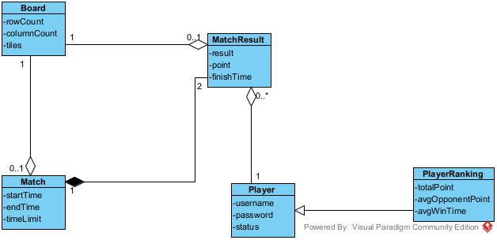

*Hình 2.1: Biểu đồ lớp thực thể của hệ thống*

| Lớp | Thuộc tính |
|---|---|
| `Player` | username, password, status (rỗi/idle, luyện tập/training, bận/busy) |
| `Match` | startTime, endTime, timeLimit |
| `MatchResult` | result (thắng, hòa, thua), point, finishTime (rỗng nếu chưa xóa hết ô) |
| `Board` | rowCount, columnCount, tiles |
| `PlayerRanking` (kế thừa `Player`) | totalPoint, avgOpponentPoint, avgWinTime |

## 3. Biểu đồ lớp pha phân tích cho bốn modul

### a. Phân tích tĩnh modul quản lý tài khoản

- Bước 1 của kịch bản, giao diện đăng nhập đề xuất lớp `LoginScreen`, cần có: ô nhập tên đăng nhập và mật khẩu, kiểu input; ô thông báo lỗi, kiểu output; nút đăng nhập và nút đăng ký, kiểu submit.
- Bước 2, giao diện đăng ký đề xuất lớp `RegisterScreen`, cần có: ô nhập tên đăng nhập, mật khẩu, nhập lại mật khẩu và tên hiển thị, kiểu input; ô thông báo lỗi, kiểu output; nút đăng ký và nút quay lại, kiểu submit.
- Bước 4, để đăng ký, cần xử lý dưới hệ thống: thêm người chơi mới nếu tên đăng nhập chưa tồn tại. Input: tên đăng nhập, mật khẩu, tên hiển thị. Output: thêm được hay không. Liên quan tới lớp `Player` nên đề xuất phương thức `addPlayer()`, gán cho lớp `Player`.
- Bước 6, để đăng nhập, cần: kiểm tra tài khoản, input là tên đăng nhập và mật khẩu, output là người chơi tương ứng hoặc rỗng; đầu ra là lớp `Player` nên đề xuất `checkLogin()`, gán cho lớp `Player`; đưa người chơi vào danh sách online, input là người chơi, output là thêm được hay không (không được nếu tài khoản đang online ở máy khác) → `addOnlinePlayer()`, gán cho lớp `Player`.
- Bước 6, giao diện chính đề xuất lớp `MainScreen`, trong modul này chỉ cần nút đăng xuất, kiểu submit.
- Bước 8, để đăng xuất, cần: xóa người chơi khỏi danh sách online. Input: người chơi. Output: thành công hay không → `removeOnlinePlayer()`, gán cho lớp `Player`.

Biểu đồ lớp pha phân tích của modul như Hình 2.2.

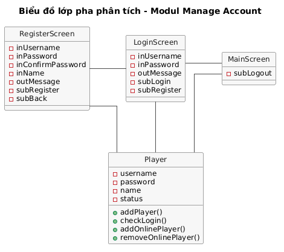

*Hình 2.2: Biểu đồ lớp pha phân tích cho modul quản lý tài khoản*

| Phương thức | Input | Output | Gán cho lớp |
|---|---|---|---|
| `addPlayer()` | tên đăng nhập, mật khẩu, tên hiển thị | thêm được hay không | `Player` |
| `checkLogin()` | tên đăng nhập, mật khẩu | người chơi hoặc rỗng | `Player` |
| `addOnlinePlayer()` | người chơi | thêm được hay không | `Player` |
| `removeOnlinePlayer()` | người chơi | thành công hay không | `Player` |

### b. Phân tích tĩnh modul xem bảng xếp hạng

- Giao diện chính đề xuất lớp `MainScreen`, trong modul này chỉ cần nút xem bảng xếp hạng, kiểu submit.
- Giao diện bảng xếp hạng đề xuất lớp `RankingScreen`, cần có: bảng xếp hạng của trang đang xem và số trang, kiểu output; nút trang trước, trang sau, vị trí của tôi và quay lại, kiểu submit.
- Để có một trang bảng xếp hạng, cần xử lý dưới hệ thống: tính ba chỉ số của mọi người chơi, sắp xếp rồi lấy các dòng của trang. Input: số trang. Output: danh sách `PlayerRanking` của trang và tổng số trang. Đầu ra là lớp `PlayerRanking` nên đề xuất phương thức `getRanking()`, gán cho lớp `PlayerRanking`.
- Để chuyển tới vị trí của mình, cần: tìm thứ hạng của người chơi rồi lấy trang chứa thứ hạng đó. Input: người chơi. Output: trang chứa người chơi, hoặc rỗng nếu người chơi chưa có trong bảng xếp hạng. Đầu ra là các `PlayerRanking` nên đề xuất phương thức `getPlayerPage()`, gán cho lớp `PlayerRanking`. Người chơi là một `Player`, và `PlayerRanking` kế thừa `Player`.

Biểu đồ lớp pha phân tích của modul như Hình 2.3.

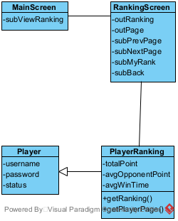

*Hình 2.3: Biểu đồ lớp pha phân tích cho modul xem bảng xếp hạng*

| Phương thức | Input | Output | Gán cho lớp |
|---|---|---|---|
| `getRanking()` | số trang | danh sách `PlayerRanking` của trang, tổng số trang | `PlayerRanking` |
| `getPlayerPage()` | người chơi | trang chứa người chơi hoặc rỗng | `PlayerRanking` |

### c. Phân tích tĩnh modul chơi với máy

- Giao diện chính đề xuất lớp `MainScreen`, trong modul này cần nút chơi với máy, kiểu submit.
- Bước 2, giao diện chọn độ khó đề xuất lớp `DifficultyScreen`, cần có: ô chọn độ khó, kiểu input; nút bắt đầu và nút quay lại, kiểu submit.
- Để bắt đầu ván, cần xử lý dưới hệ thống: sinh đề bài. Input: số hàng, số cột. Output: một bàn chơi. Đầu ra là lớp `Board` nên đề xuất phương thức `generateBoard()`, gán cho lớp `Board`.
- Bước 4, giao diện chơi đề xuất lớp `BotGameScreen`, cần có: bàn chơi, đồng hồ, số ô còn lại của người chơi và của máy, kiểu output; ô người chơi click, kiểu input; nút thoát, kiểu submit.
- Khi người chơi chọn hai ô, cần xử lý dưới hệ thống, đều có input là bàn chơi và hai ô, đều liên quan tới lớp `Board`:
  - kiểm tra hai ô nối được bằng tối đa 3 đoạn thẳng, output là đường nối hoặc rỗng → `checkPath()`;
  - xóa hai ô, output là bàn chơi mới → `removePair()`;
  - kiểm tra bàn đã hết ô chưa, output đúng hoặc sai → `isCleared()`.
- Máy chơi và việc phát hiện bế tắc cần: tìm một cặp ô còn nối được trên bàn, output là cặp ô hoặc rỗng → `findAvailablePair()`; xáo lại các ô còn lại khi bế tắc → `shuffle()`. Cả hai gán cho lớp `Board`.
- Bước 8, dialog kết quả đề xuất lớp `BotResultDialog`, cần có: kết quả, kiểu output; nút OK, kiểu submit.

Biểu đồ lớp pha phân tích của modul như Hình 2.4.

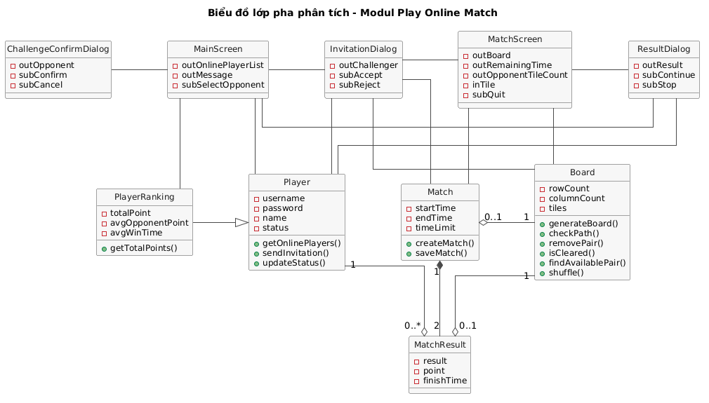

*Hình 2.4: Biểu đồ lớp pha phân tích cho modul chơi với máy*

| Phương thức | Input | Output | Gán cho lớp |
|---|---|---|---|
| `generateBoard()` | số hàng, số cột | bàn chơi | `Board` |
| `checkPath()` | bàn chơi, hai ô | đường nối hoặc rỗng | `Board` |
| `removePair()` | bàn chơi, hai ô | bàn chơi mới | `Board` |
| `isCleared()` | bàn chơi | đúng hoặc sai | `Board` |
| `findAvailablePair()` | bàn chơi | một cặp ô nối được hoặc rỗng | `Board` |
| `shuffle()` | bàn chơi | bàn chơi đã xáo | `Board` |

### d. Phân tích tĩnh modul thách đấu và đấu đối kháng

- Giao diện chính đề xuất lớp `MainScreen`, trong modul này cần nút đấu đối kháng, kiểu submit.
- Màn hình đấu đối kháng đề xuất lớp `LobbyScreen`, cần có: danh sách người chơi online, kiểu output; thông báo (bị từ chối, đối thủ bận, không trả lời, đã dừng chơi), kiểu output; tên đối thủ để click và nút quay lại, kiểu submit.
- Để hiện danh sách online, cần: lấy các người chơi đang online, output là danh sách `Player` → `getOnlinePlayers()`, gán cho `Player`; lấy tổng điểm của các người chơi đó, output là các `PlayerRanking` → `getTotalPoints()`, gán cho `PlayerRanking`.
- Dialog xác nhận thách đấu trên máy người thách đấu đề xuất lớp `ChallengeConfirmDialog`. Sau khi xác nhận, chính dialog này đổi thành popup chờ để người mời hủy được lời mời. Cần có: tên đối thủ, thông báo đang chờ và thời gian còn lại, kiểu output; nút Xác nhận và nút Hủy (sau khi xác nhận là nút Hủy lời mời), kiểu submit.
- Khi người thách đấu click Xác nhận, cần: ghi nhận và gửi lời mời, input là người mời và người được mời, đều là `Player`, output là gửi được hay lý do không gửi được (người được mời bận hoặc không online) → `sendInvitation()`, gán cho `Player`.
- Khi người mời click Hủy lời mời, cần: hủy lời mời đang chờ, input là người mời và người được mời → `cancelInvitation()`, gán cho `Player`.
- Popup lời mời trên máy người được mời đề xuất lớp `InvitationDialog`, cần có: tên người mời và thời gian còn lại, kiểu output; nút Accept và nút Reject, kiểu submit.
- Khi người được mời click Accept hoặc Reject, cần: ghi nhận câu trả lời, kiểm tra lời mời còn hiệu lực (chưa bị hủy, chưa hết 30 giây) và báo cho người mời; input là người mời, người được mời và câu trả lời; output là lời mời còn hiệu lực hay không → `replyInvitation()`, gán cho `Player`.
- Khi người được mời chấp nhận, cần: sinh đề bài → `Board.generateBoard()`; tạo ván đấu cho hai người với đề bài vừa sinh, output là `Match` → `createMatch()`, gán cho `Match`; chuyển trạng thái hai người sang bận, input là các `Player` → `updateStatus()`, gán cho `Player`.
- Giao diện chơi đề xuất lớp `MatchScreen`, cần có: bàn chơi, đồng hồ, số ô còn lại của đối thủ, kiểu output; ô người chơi click, kiểu input; nút thoát, kiểu submit. Các xử lý khi chọn hai ô dùng lại `checkPath()`, `removePair()`, `isCleared()`, `findAvailablePair()`, `shuffle()` của `Board`.
- Khi ván kết thúc, cần: xác định kết quả và điểm của hai người theo cách kết thúc (xóa hết ô, hết giờ, thoát, mất kết nối), input là ván và cách kết thúc, output là hai kết quả → `endMatch()`; lưu ván cùng hai kết quả, input là ván và kết quả của hai người → `saveMatch()`. Cả hai gán cho `Match` vì `Match` gắn chặt với hai `MatchResult`.
- Dialog kết quả đề xuất lớp `ResultDialog`, cần có: kết quả, điểm nhận được và thời gian còn lại để trả lời, kiểu output; nút tái đấu và nút dừng, kiểu submit.
- Khi người chơi chọn tái đấu hoặc dừng, cần: ghi nhận lựa chọn của người đó trong ván, input là ván, người chơi và lựa chọn, output là cả hai đã đồng ý, có người dừng, hoặc còn chờ người kia → `replyRematch()`, gán cho `Match`. Có người dừng thì chuyển trạng thái hai người về rỗi bằng `Player.updateStatus()` rồi về `LobbyScreen`. Khi cả hai chọn tái đấu, dùng lại `Board.generateBoard()` và `Match.createMatch()` để tạo ván mới, nên `ResultDialog` liên kết với `Board` và `Match`.

Biểu đồ lớp pha phân tích của modul như Hình 2.5.

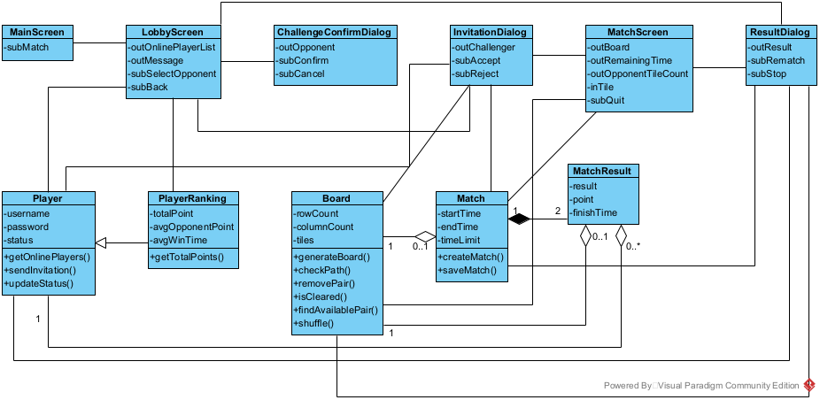

*Hình 2.5: Biểu đồ lớp pha phân tích cho modul thách đấu và đấu đối kháng*

| Phương thức | Input | Output | Gán cho lớp |
|---|---|---|---|
| `getOnlinePlayers()` | không có | danh sách `Player` đang online | `Player` |
| `sendInvitation()` | người mời, người được mời | gửi được, hoặc lý do không gửi được | `Player` |
| `cancelInvitation()` | người mời, người được mời | hủy được hay không | `Player` |
| `replyInvitation()` | người mời, người được mời, câu trả lời | lời mời còn hiệu lực hay không | `Player` |
| `updateStatus()` | danh sách người chơi, trạng thái mới | thành công hay không | `Player` |
| `getTotalPoints()` | danh sách người chơi | các `PlayerRanking` tương ứng | `PlayerRanking` |
| `createMatch()` | hai người chơi, đề bài | `Match` | `Match` |
| `endMatch()` | ván đấu, cách kết thúc | kết quả và điểm của hai người | `Match` |
| `saveMatch()` | ván đấu, kết quả của hai người | thành công hay không | `Match` |
| `replyRematch()` | ván đấu, người chơi, lựa chọn tái đấu hay dừng | cả hai đồng ý, có người dừng hoặc còn chờ | `Match` |
| `generateBoard()`, `checkPath()`, `removePair()`, `isCleared()`, `findAvailablePair()`, `shuffle()` | như modul chơi với máy | như modul chơi với máy | `Board` |

## 4. Biểu đồ trạng thái cho bốn modul

### a. Biểu đồ trạng thái modul quản lý tài khoản

- Từ giao diện đăng nhập, khi click đăng ký thì hệ thống chuyển sang giao diện đăng ký; khi click đăng nhập mà sai tài khoản thì hiện lại giao diện đăng nhập kèm thông báo; nếu đúng thì chuyển sang giao diện chính.
- Từ giao diện đăng ký, khi click đăng ký mà thiếu thông tin hoặc tên đăng nhập đã tồn tại thì hiện lại giao diện đăng ký kèm thông báo; nếu đăng ký thành công hoặc click quay lại thì trở về giao diện đăng nhập.
- Từ giao diện chính, khi click đăng xuất thì hệ thống trở về giao diện đăng nhập.

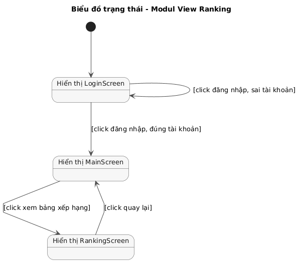

*Hình 2.6: Biểu đồ trạng thái của modul quản lý tài khoản*

### b. Biểu đồ trạng thái modul xem bảng xếp hạng

- Từ giao diện chính, khi click xem bảng xếp hạng thì hệ thống chuyển sang giao diện bảng xếp hạng.
- Tại giao diện bảng xếp hạng, khi click trang trước, trang sau hoặc vị trí của tôi thì hệ thống hiện lại chính giao diện đó với trang tương ứng; khi click quay lại thì trở về giao diện chính.

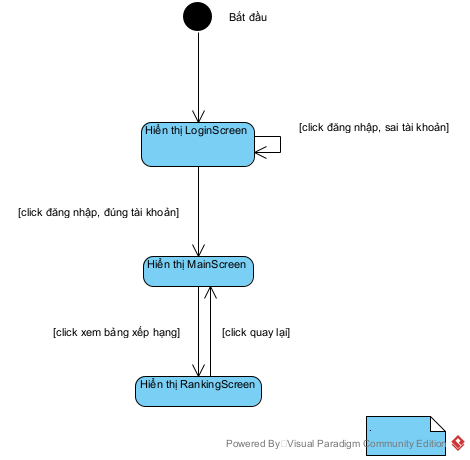

*Hình 2.7: Biểu đồ trạng thái của modul xem bảng xếp hạng*

### c. Biểu đồ trạng thái modul chơi với máy

- Từ giao diện chính, khi click chơi với máy thì hệ thống chuyển sang giao diện chọn độ khó.
- Từ giao diện chọn độ khó, khi click quay lại thì trở về giao diện chính; khi click bắt đầu thì chuyển sang giao diện chơi.
- Tại giao diện chơi, mỗi lần click hai ô thì hệ thống hiện lại chính giao diện đó với bàn chơi mới; khi click thoát thì trở về giao diện chính; khi một bên xóa hết ô hoặc hết giờ thì chuyển sang dialog kết quả.
- Từ dialog kết quả, khi click OK thì trở về giao diện chính.

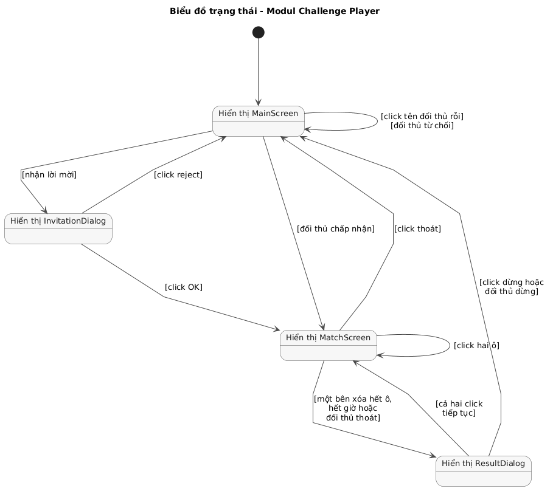

*Hình 2.8: Biểu đồ trạng thái của modul chơi với máy*

### d. Biểu đồ trạng thái modul thách đấu và đấu đối kháng

- Tại giao diện chính, khi click đấu đối kháng thì hệ thống chuyển sang màn hình đấu đối kháng; nếu chưa đăng nhập thì qua giao diện đăng nhập trước, đăng nhập thành công mới chuyển sang màn hình đấu đối kháng.
- Tại màn hình đấu đối kháng, khi click quay lại thì trở về giao diện chính; khi click tên một đối thủ không bận thì hệ thống hiện dialog xác nhận thách đấu.
- Từ dialog xác nhận, click hủy thì trở về màn hình đấu đối kháng; click xác nhận thì dialog chuyển sang popup chờ đối thủ trả lời.
- Từ popup chờ, nếu đối thủ chấp nhận thì chuyển sang giao diện chơi; nếu click hủy lời mời, đối thủ từ chối, đối thủ bận hoặc hết 30 giây thì trở về màn hình đấu đối kháng kèm thông báo tương ứng.
- Khi nhận lời mời thì hệ thống hiện popup lời mời. Lời mời đến được ở mọi màn hình sau khi đăng nhập trừ giao diện chơi đối kháng; biểu đồ vẽ trường hợp đang ở màn hình đấu đối kháng. Từ popup lời mời, click reject, hết 30 giây hoặc người mời hủy thì trở về màn hình trước đó; click accept thì chuyển sang giao diện chơi.
- Tại giao diện chơi, mỗi lần click hai ô thì hệ thống hiện lại chính giao diện đó; khi click thoát thì trở về màn hình đấu đối kháng kèm thông báo bị xử thua; khi một bên xóa hết ô, hết giờ, đối thủ thoát hoặc đối thủ mất kết nối thì chuyển sang dialog kết quả.
- Tại dialog kết quả, khi click tái đấu mà đối thủ chưa chọn thì hệ thống hiện lại chính dialog đó với thông báo đang chờ; nếu cả hai click tái đấu thì chuyển sang giao diện chơi của ván mới; nếu click dừng, click về sảnh (khi đối thủ đã thoát), đối thủ dừng hoặc hết 30 giây thì trở về màn hình đấu đối kháng.

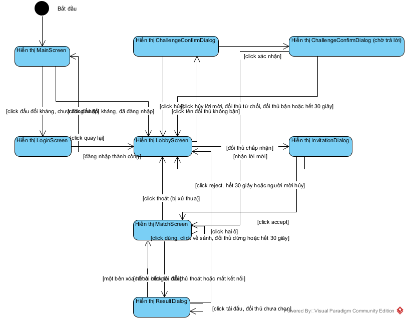

*Hình 2.9: Biểu đồ trạng thái của modul thách đấu và đấu đối kháng*

## 5. Kịch bản chi tiết phiên bản 2 và biểu đồ tương tác cho bốn modul

Sau kịch bản phiên bản 2 của mỗi modul là biểu đồ tương tác của modul đó. Mỗi thông điệp ứng với một bước của kịch bản phiên bản 2 cùng số thứ tự, và chỉ đi giữa hai lớp có liên kết trong biểu đồ lớp phân tích của modul. Modul xem bảng xếp hạng và modul thách đấu dùng biểu đồ tuần tự cho dễ đọc; modul quản lý tài khoản và modul chơi với máy dùng biểu đồ giao tiếp, trong đó dấu `*` đánh dấu các bước nằm trong vòng lặp.

### a. Kịch bản phiên bản 2 và biểu đồ giao tiếp modul quản lý tài khoản

1. Tại giao diện đăng nhập, người chơi click nút Đăng ký.
2. Lớp `LoginScreen` gọi lớp `RegisterScreen`.
3. Lớp `RegisterScreen` hiển thị cho người chơi.
4. Người chơi nhập tên đăng nhập, mật khẩu, nhập lại mật khẩu, tên hiển thị và click nút Đăng ký.
5. Lớp `RegisterScreen` gọi lớp `Player` yêu cầu thêm người chơi mới.
6. Lớp `Player` kiểm tra tên đăng nhập chưa tồn tại và lưu người chơi.
7. Lớp `Player` trả kết quả cho lớp `RegisterScreen`.
8. Lớp `RegisterScreen` gọi lớp `LoginScreen`, kèm tên đăng nhập vừa đăng ký.
9. Lớp `LoginScreen` hiển thị thông báo đăng ký thành công cho người chơi.
10. Người chơi nhập mật khẩu và click nút Đăng nhập.
11. Lớp `LoginScreen` gọi lớp `Player` yêu cầu kiểm tra đăng nhập.
12. Lớp `Player` kiểm tra tên đăng nhập và mật khẩu.
13. Lớp `Player` trả kết quả cho lớp `LoginScreen`.
14. Lớp `LoginScreen` gọi lớp `Player` yêu cầu thêm người chơi vào danh sách online.
15. Lớp `Player` thêm người chơi vào danh sách online.
16. Lớp `Player` trả kết quả cho lớp `LoginScreen`.
17. Lớp `LoginScreen` gọi lớp `MainScreen`.
18. Lớp `MainScreen` hiển thị cho người chơi.
19. Người chơi click nút Đăng xuất.
20. Lớp `MainScreen` gọi lớp `Player` yêu cầu xóa người chơi khỏi danh sách online.
21. Lớp `Player` xóa người chơi khỏi danh sách online.
22. Lớp `Player` trả kết quả cho lớp `MainScreen`.
23. Lớp `MainScreen` gọi lớp `LoginScreen`.
24. Lớp `LoginScreen` hiển thị cho người chơi.

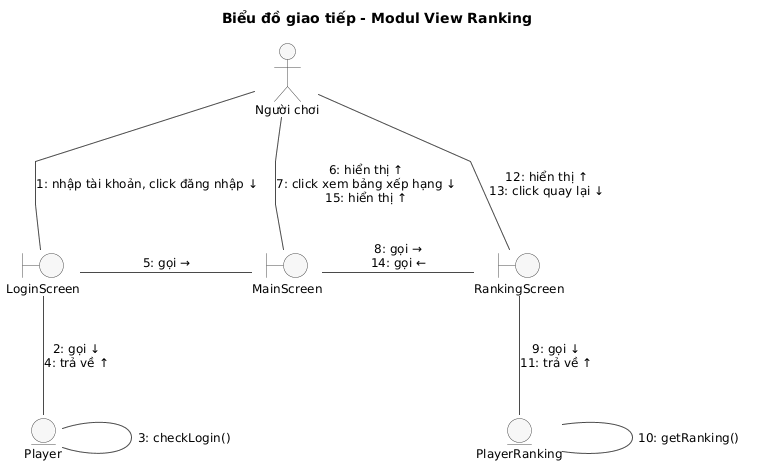

*Hình 2.10: Biểu đồ giao tiếp của modul quản lý tài khoản*

### b. Kịch bản phiên bản 2 và biểu đồ tuần tự modul xem bảng xếp hạng

1. Tại giao diện chính, người chơi click nút Xem bảng xếp hạng.
2. Lớp `MainScreen` gọi lớp `RankingScreen`.
3. Lớp `RankingScreen` gọi lớp `PlayerRanking` yêu cầu lấy trang 1 của bảng xếp hạng.
4. Lớp `PlayerRanking` tính tổng điểm, trung bình điểm đối thủ, trung bình thời gian thắng của mọi người chơi, sắp xếp và lấy các dòng của trang 1.
5. Lớp `PlayerRanking` trả kết quả cho lớp `RankingScreen`.
6. Lớp `RankingScreen` hiển thị trang 1 của bảng xếp hạng cho người chơi.
7. Người chơi click nút Vị trí của tôi.
8. Lớp `RankingScreen` gọi lớp `PlayerRanking` yêu cầu lấy trang chứa người chơi.
9. Lớp `PlayerRanking` tìm thứ hạng của người chơi và lấy các dòng của trang chứa thứ hạng đó.
10. Lớp `PlayerRanking` trả kết quả cho lớp `RankingScreen`.
11. Lớp `RankingScreen` hiển thị trang chứa người chơi, tô màu dòng của người chơi.
12. Người chơi click nút Quay lại.
13. Lớp `RankingScreen` gọi lớp `MainScreen`.
14. Lớp `MainScreen` hiển thị cho người chơi.

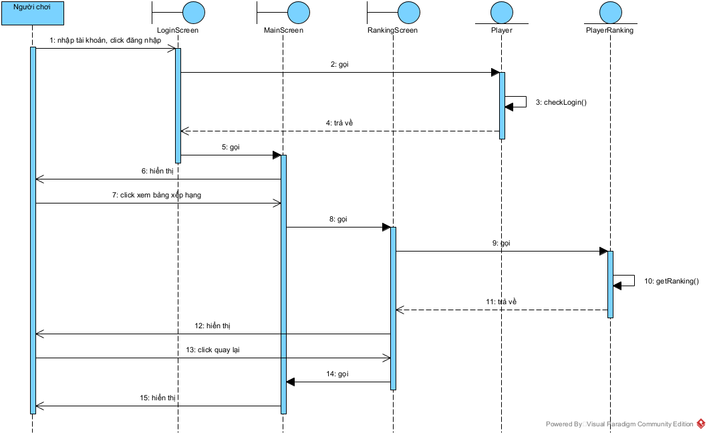

*Hình 2.11: Biểu đồ tuần tự pha phân tích của modul xem bảng xếp hạng*

### c. Kịch bản phiên bản 2 và biểu đồ giao tiếp modul chơi với máy

1. Tại giao diện chính, người chơi click nút Chơi với máy.
2. Lớp `MainScreen` gọi lớp `DifficultyScreen`.
3. Lớp `DifficultyScreen` hiển thị cho người chơi.
4. Người chơi chọn độ khó Trung bình và click nút Bắt đầu.
5. Lớp `DifficultyScreen` gọi lớp `Board` yêu cầu sinh đề bài 10x10.
6. Lớp `Board` sinh đề bài.
7. Lớp `Board` trả đề bài cho lớp `DifficultyScreen`.
8. Lớp `DifficultyScreen` gọi lớp `BotGameScreen`, kèm đề bài và độ khó.
9. Lớp `BotGameScreen` hiển thị bàn chơi, đồng hồ và số ô còn lại cho người chơi, đồng thời cho máy bắt đầu chơi trên một bản sao của đề bài.
10. Người chơi click lần lượt hai ô cùng hình.
11. Lớp `BotGameScreen` gọi lớp `Board` yêu cầu kiểm tra đường nối giữa hai ô.
12. Lớp `Board` tìm đường nối gồm tối đa 3 đoạn thẳng.
13. Lớp `Board` trả đường nối cho lớp `BotGameScreen`.
14. Lớp `BotGameScreen` gọi lớp `Board` yêu cầu xóa hai ô.
15. Lớp `Board` xóa hai ô.
16. Lớp `Board` trả bàn chơi mới cho lớp `BotGameScreen`.
17. Lớp `BotGameScreen` gọi lớp `Board` yêu cầu kiểm tra bàn đã hết ô chưa.
18. Lớp `Board` kiểm tra số ô còn lại.
19. Lớp `Board` trả kết quả cho lớp `BotGameScreen`.
20. Lớp `BotGameScreen` vẽ đường nối, hiển thị bàn chơi mới và số ô còn lại cho người chơi.
21. Đến lượt máy theo thời gian của độ khó, lớp `BotGameScreen` gọi lớp `Board` của máy yêu cầu tìm một cặp ô nối được.
22. Lớp `Board` tìm một cặp ô nối được.
23. Lớp `Board` trả cặp ô cho lớp `BotGameScreen`.
24. Lớp `BotGameScreen` gọi lớp `Board` của máy yêu cầu xóa cặp ô đó.
25. Lớp `Board` xóa hai ô.
26. Lớp `Board` trả bàn chơi mới cho lớp `BotGameScreen`.
27. Lớp `BotGameScreen` hiển thị số ô còn lại của máy cho người chơi.
(Lặp lại các bước 10-27 cho đến khi bước 19 trả về người chơi đã xóa hết ô.)
28. Lớp `BotGameScreen` dừng đồng hồ và gọi lớp `BotResultDialog`.
29. Lớp `BotResultDialog` hiển thị kết quả cho người chơi.
30. Người chơi click nút OK.
31. Lớp `BotResultDialog` gọi lớp `MainScreen`.
32. Lớp `MainScreen` hiển thị cho người chơi.

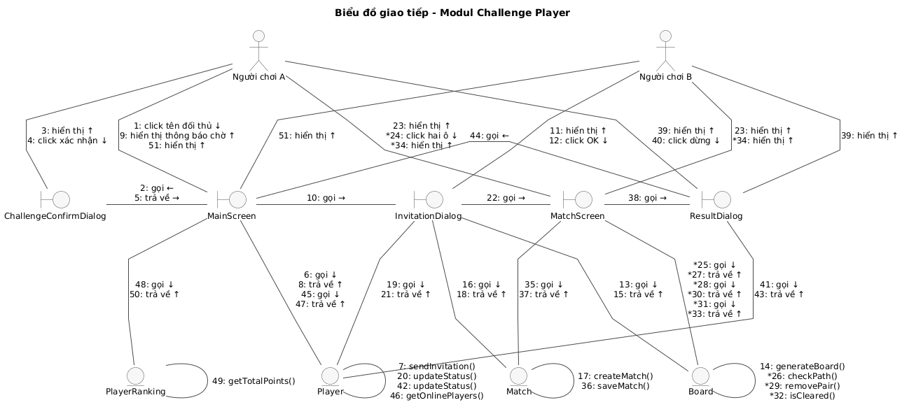

*Hình 2.12: Biểu đồ giao tiếp của modul chơi với máy*

### d. Kịch bản phiên bản 2 và biểu đồ tuần tự modul thách đấu và đấu đối kháng

1. Tại giao diện chính, người chơi A click nút Đấu đối kháng.
2. Lớp `MainScreen` gọi lớp `LobbyScreen`.
3. Lớp `LobbyScreen` gọi lớp `Player` yêu cầu lấy danh sách người chơi online.
4. Lớp `Player` lấy danh sách người chơi đang online.
5. Lớp `Player` trả danh sách cho lớp `LobbyScreen`.
6. Lớp `LobbyScreen` gọi lớp `PlayerRanking` yêu cầu lấy tổng điểm của các người chơi trong danh sách.
7. Lớp `PlayerRanking` tính tổng điểm.
8. Lớp `PlayerRanking` trả kết quả cho lớp `LobbyScreen`.
9. Lớp `LobbyScreen` hiển thị danh sách người chơi online cho A.
10. A click vào tên người chơi B đang không bận (rỗi hoặc luyện tập).
11. Lớp `LobbyScreen` gọi lớp `ChallengeConfirmDialog`.
12. Lớp `ChallengeConfirmDialog` hiển thị dialog xác nhận thách đấu B cho A.
13. A click nút Xác nhận.
14. Lớp `ChallengeConfirmDialog` gọi lớp `Player` yêu cầu gửi lời mời từ A tới B.
15. Lớp `Player` kiểm tra B không bận, ghi nhận và gửi lời mời.
16. Lớp `Player` trả kết quả cho lớp `ChallengeConfirmDialog`.
17. Lớp `ChallengeConfirmDialog` hiển thị popup đang chờ B trả lời, đếm ngược 30 giây, kèm nút Hủy lời mời cho A.
18. Lớp `LobbyScreen` trên máy của B nhận lời mời và gọi lớp `InvitationDialog`.
19. Lớp `InvitationDialog` hiển thị popup lời mời, đếm ngược 30 giây, cho B.
20. B click nút Accept.
21. Lớp `InvitationDialog` gọi lớp `Player` yêu cầu ghi nhận B chấp nhận lời mời của A.
22. Lớp `Player` kiểm tra lời mời còn hiệu lực và gỡ lời mời.
23. Lớp `Player` trả kết quả cho lớp `InvitationDialog`.
24. Lớp `InvitationDialog` gọi lớp `Board` yêu cầu sinh đề bài 10x10.
25. Lớp `Board` sinh đề bài.
26. Lớp `Board` trả đề bài cho lớp `InvitationDialog`.
27. Lớp `InvitationDialog` gọi lớp `Match` yêu cầu tạo ván đấu cho A và B với đề bài vừa sinh.
28. Lớp `Match` tạo ván đấu.
29. Lớp `Match` trả ván đấu cho lớp `InvitationDialog`.
30. Lớp `InvitationDialog` gọi lớp `Player` yêu cầu chuyển trạng thái A và B sang bận.
31. Lớp `Player` cập nhật trạng thái.
32. Lớp `Player` trả kết quả cho lớp `InvitationDialog`.
33. Lớp `InvitationDialog` gọi lớp `MatchScreen` trên máy của cả hai người chơi.
34. Lớp `MatchScreen` hiển thị bàn chơi, đồng hồ và số ô còn lại của đối thủ cho A và B.
35. A click lần lượt hai ô cùng hình.
36. Lớp `MatchScreen` gọi lớp `Board` yêu cầu kiểm tra đường nối giữa hai ô.
37. Lớp `Board` tìm đường nối gồm tối đa 3 đoạn thẳng.
38. Lớp `Board` trả đường nối cho lớp `MatchScreen`.
39. Lớp `MatchScreen` gọi lớp `Board` yêu cầu xóa hai ô.
40. Lớp `Board` xóa hai ô.
41. Lớp `Board` trả bàn chơi mới cho lớp `MatchScreen`.
42. Lớp `MatchScreen` gọi lớp `Board` yêu cầu kiểm tra bàn đã hết ô chưa.
43. Lớp `Board` kiểm tra số ô còn lại.
44. Lớp `Board` trả kết quả cho lớp `MatchScreen`.
45. Lớp `MatchScreen` vẽ đường nối, hiển thị bàn chơi mới cho A và số ô còn lại của A cho B.
(Lặp lại các bước 35-45 cho đến khi bước 44 trả về A đã xóa hết ô; B chơi song song theo cùng các bước trên máy của mình.)
46. Lớp `MatchScreen` gọi lớp `Match` yêu cầu kết thúc ván vì bàn của A đã hết ô.
47. Lớp `Match` xác định kết quả: A thắng kèm thời gian hoàn thành, B thua; tính điểm của hai người.
48. Lớp `Match` lưu ván đấu và hai kết quả.
49. Lớp `Match` trả kết quả cho lớp `MatchScreen`.
50. Lớp `MatchScreen` gọi lớp `ResultDialog` trên máy của cả hai người chơi.
51. Lớp `ResultDialog` hiển thị kết quả, điểm nhận được và câu hỏi có muốn tái đấu không, đếm ngược 30 giây, cho A và B.
52. A click nút Dừng.
53. Lớp `ResultDialog` gọi lớp `Match` yêu cầu ghi nhận A chọn dừng.
54. Lớp `Match` ghi nhận A dừng: ván không được tái đấu.
55. Lớp `Match` trả kết quả cho lớp `ResultDialog`.
56. Lớp `ResultDialog` gọi lớp `Player` yêu cầu chuyển trạng thái A và B về rỗi.
57. Lớp `Player` cập nhật trạng thái.
58. Lớp `Player` trả kết quả cho lớp `ResultDialog`.
59. Lớp `ResultDialog` gọi lớp `LobbyScreen` trên máy của cả hai người chơi.
60. Lớp `LobbyScreen` gọi lớp `Player` yêu cầu lấy danh sách người chơi online.
61. Lớp `Player` lấy danh sách người chơi đang online.
62. Lớp `Player` trả danh sách cho lớp `LobbyScreen`.
63. Lớp `LobbyScreen` gọi lớp `PlayerRanking` yêu cầu lấy tổng điểm của các người chơi trong danh sách.
64. Lớp `PlayerRanking` tính tổng điểm.
65. Lớp `PlayerRanking` trả kết quả cho lớp `LobbyScreen`.
66. Lớp `LobbyScreen` hiển thị danh sách người chơi online đã cập nhật cho A và B, kèm thông báo đối thủ đã dừng chơi cho B.

Người chơi A và người chơi B là hai actor cùng loại `Player` trên hai máy client. Một bước hiển thị trên cả hai máy được vẽ thành hai thông điệp cùng số, thêm hậu tố `a` (cho A) và `b` (cho B). Biểu đồ vẽ đủ các bước 1–66 của kịch bản phiên bản 2 trong một biểu đồ, kể cả phần chơi ván (bước 35–45, thuộc modul của Dev 1); vì dài nên ảnh được cắt thành hai phần, mỗi phần lặp lại hàng đầu lifeline (Hình 2.13, 2.14). Nhánh tái đấu khi cả hai chọn tái đấu ở Hình 2.15.

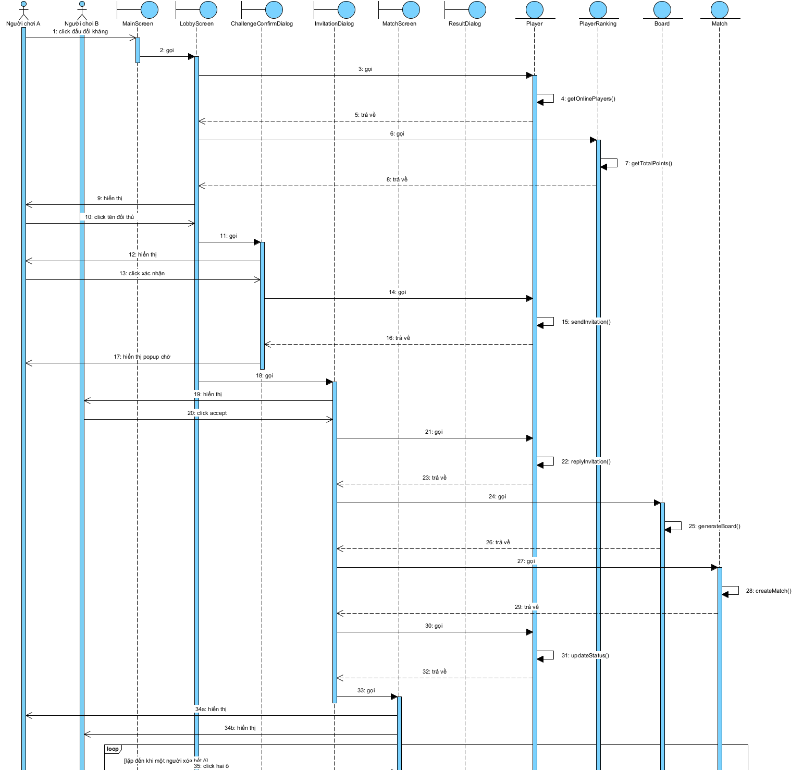

*Hình 2.13: Biểu đồ tuần tự pha phân tích của modul thách đấu và đấu đối kháng (phần 1/2)*

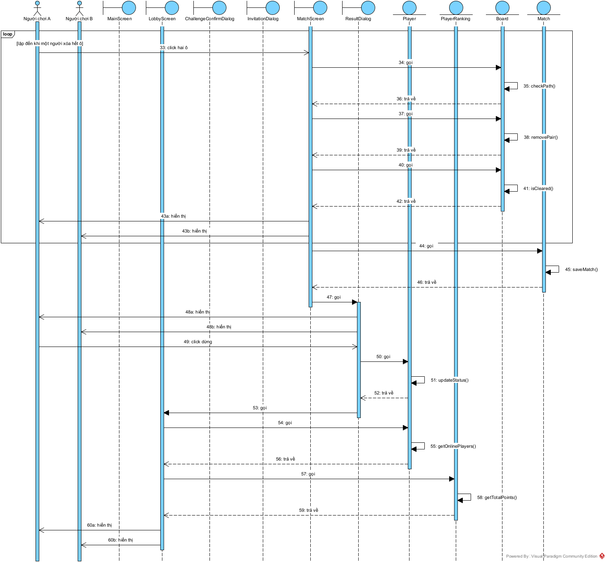

*Hình 2.14: Biểu đồ tuần tự pha phân tích của modul thách đấu và đấu đối kháng (phần 2/2)*

Nhánh 13a của kịch bản v1 (cả hai người chơi chọn tái đấu) thay cho các bước 52–66:

1. Tại dialog kết quả, A click nút Tái đấu.
2. Lớp `ResultDialog` gọi lớp `Match` yêu cầu ghi nhận A chọn tái đấu.
3. Lớp `Match` ghi nhận A đồng ý, B chưa trả lời.
4. Lớp `Match` trả kết quả cho lớp `ResultDialog`.
5. Lớp `ResultDialog` hiển thị thông báo đang chờ đối thủ trả lời cho A.
6. B click nút Tái đấu.
7. Lớp `ResultDialog` gọi lớp `Match` yêu cầu ghi nhận B chọn tái đấu.
8. Lớp `Match` ghi nhận B đồng ý: cả hai đã đồng ý.
9. Lớp `Match` trả kết quả cho lớp `ResultDialog`.
10. Lớp `ResultDialog` gọi lớp `Board` yêu cầu sinh đề bài 10x10 mới.
11. Lớp `Board` sinh đề bài.
12. Lớp `Board` trả đề bài cho lớp `ResultDialog`.
13. Lớp `ResultDialog` gọi lớp `Match` yêu cầu tạo ván mới cho A và B với đề bài vừa sinh.
14. Lớp `Match` tạo ván đấu.
15. Lớp `Match` trả ván đấu cho lớp `ResultDialog`.
16. Lớp `ResultDialog` gọi lớp `MatchScreen` trên máy của cả hai người chơi.
17. Lớp `MatchScreen` hiển thị bàn chơi mới, đồng hồ và số ô còn lại của đối thủ cho A và B; trạng thái hai người vẫn là bận.

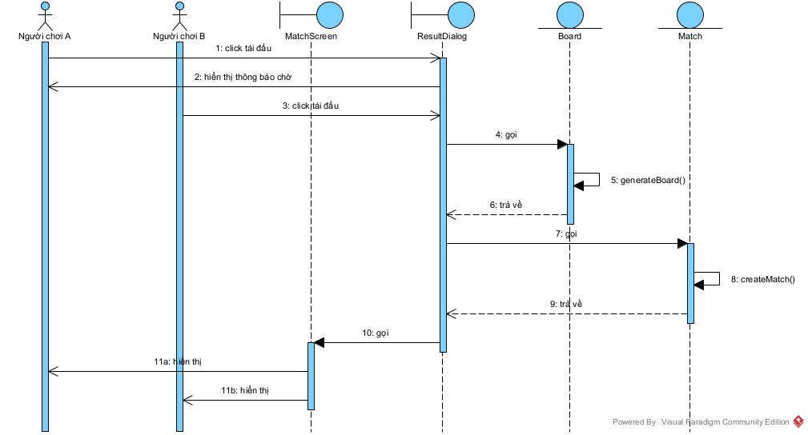

*Hình 2.15: Biểu đồ tuần tự pha phân tích của modul thách đấu và đấu đối kháng, nhánh tái đấu*
