# Pha 3. Thiết kế

> Bản nháp. Các điểm còn mở ở `plan.md` §8 (AWT với ván thắng do đối thủ bỏ cuộc, số loại icon, hệ quản trị CSDL...) được viết theo phương án đề xuất ghi ở đó; khi chốt khác thì sửa lại các mục liên quan.

## 1. Thiết kế lớp thực thể

Đầu vào là biểu đồ lớp thực thể pha phân tích (Hình 2.1). Ngôn ngữ cài đặt là Java cho cả client Android, server và thư viện dùng chung `core`; các lớp thực thể đặt trong `core` để client và server dùng chung một định nghĩa.

### a. Bổ sung thuộc tính id

- `Player`, `Match`, `MatchResult` được lưu vào cơ sở dữ liệu nên được bổ sung thuộc tính `id`.
- `Board` không có `id`: bàn của ván với máy không được lưu, còn đề bài của ván đối kháng và bàn riêng của từng người được lưu chung với ván đấu và kết quả (gộp vào bảng ván đấu và bảng kết quả ở mục 2).
- `PlayerRanking` kế thừa `Player` nên dùng `id` của `Player`, không bổ sung `id` riêng (giống các lớp thống kê kế thừa lớp thực thể trong giáo trình).

### b. Bổ sung kiểu dữ liệu

- `Player`: `id : int`, `username : String`, `password : String` (giá trị băm SHA-256 của mật khẩu, không lưu mật khẩu gốc), `name : String`, `status : String` (`IDLE`: rỗi, `TRAINING`: luyện tập, `BUSY`: bận).
- `Match`: `id : int`, `startTime : Date`, `endTime : Date`, `timeLimit : int` (số giây, mặc định 600).
- `MatchResult`: `id : int`, `result : String` (WIN, DRAW, LOSE), `point : float` (điểm của ván theo đề: thắng 1, hòa 0.5, thua 0; suy ra từ `result`), `finishTime : Integer` (số mili giây tính từ lúc bắt đầu ván, rỗng nếu người chơi chưa xóa hết ô). Dùng kiểu bọc `Integer` để biểu diễn được giá trị rỗng.
- `Board`: `rowCount : int`, `columnCount : int`, `tiles : int[][]`. `rowCount`, `columnCount` là kích thước cả lưới (12 x 12): vùng chơi 10x10 ở giữa và một vòng viền trống để đường nối có thể đi vòng ra ngoài. Ô trống có giá trị 0, ô có hình mang mã hình từ 1 trở đi.
- `PlayerRanking`: kế thừa các thuộc tính của `Player`, thêm `totalPoint : float`, `avgOpponentPoint : float`, `avgWinTime : Float` (rỗng nếu người chơi chưa thắng ván nào có thời gian hoàn thành).
- Đơn vị thời gian: `timeLimit` là thời lượng cấu hình nên tính bằng giây (khớp trường `timeLimitSec` của giao thức); `finishTime`, `avgWinTime` là thời lượng đo được nên tính bằng mili giây, khi hiển thị đổi sang mm:ss.

### c. Chuyển quan hệ association sang aggregation, composition

Biểu đồ lớp thực thể pha phân tích đã xác định quan hệ đối tượng ở bước 5, nên giữ nguyên:

- `Match` ◆ `MatchResult` (1 - 2): kết quả sinh ra và mất đi cùng ván đấu.
- `MatchResult` ◇ `Player` (0..* - 1), `Match` ◇ `Board` (0..1 - 1) và `MatchResult` ◇ `Board` (0..1 - 1). Cùng lớp `Board` đóng hai vai: đề bài ban đầu của ván và bàn riêng của từng người, hai bàn này khác nhau ngay sau nước đi đầu tiên.
- `PlayerRanking` ▷ `Player` (kế thừa): mỗi dòng xếp hạng là một người chơi kèm các chỉ số thống kê, nên có sẵn tên người chơi để hiển thị mà không cần thuộc tính đối tượng riêng.

### d. Bổ sung thuộc tính đối tượng

- `Match` chứa `board : Board` và `results : MatchResult[]` (mảng hai phần tử).
- `MatchResult` chứa `player : Player` và `board : Board` (bàn riêng của người chơi trong ván).
- `PlayerRanking` không cần thuộc tính đối tượng vì đã kế thừa `Player`.

Ngoài các lớp thực thể, `core` có lớp giá trị `Cell` (`row : int`, `col : int`) biểu diễn toạ độ một ô, dùng làm tham số cho các phương thức xử lý bàn chơi. `Cell` không phải lớp thực thể vì không được quản lý hay lưu trữ.

Kết quả thu được biểu đồ lớp thực thể pha thiết kế như Hình 3.1.

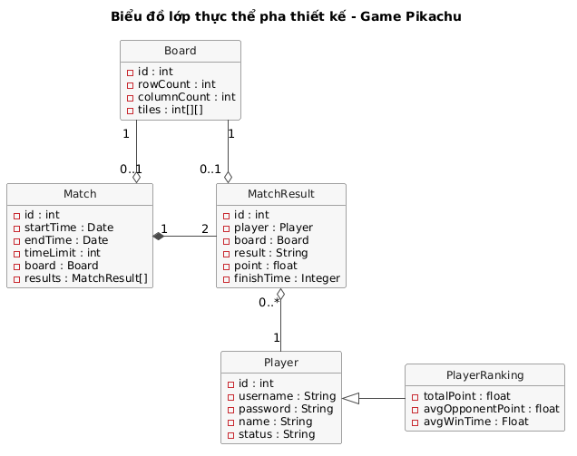

*Hình 3.1: Biểu đồ lớp thực thể pha thiết kế*

## 2. Thiết kế cơ sở dữ liệu

Cơ sở dữ liệu đặt trên server, hệ quản trị đề xuất là MySQL (`plan.md` §8).

### a. Mỗi lớp thực thể một bảng

`Player` → `tblPlayer`, `Match` → `tblMatch`, `MatchResult` → `tblMatchResult`, `Board` → `tblBoard`, `PlayerRanking` → `tblPlayerRanking`. `PlayerRanking` kế thừa `Player` nên `tblPlayerRanking` không có `id` riêng mà dùng khóa `playerId` tham chiếu `tblPlayer` (giống `tblSinhvien` dùng `tblThanhvienid` trong giáo trình); bảng này bị loại ở bước e.

### b. Bỏ thuộc tính kiểu đối tượng, đổi kiểu dữ liệu

- Bỏ `Match.board`, `Match.results`, `MatchResult.player`, `MatchResult.board`.
- `int`, `Integer` → `int(10)`, `String` → `varchar`, `Date` → `datetime` (các thuộc tính `float` chỉ có ở `point` và `PlayerRanking`, đều là dẫn xuất nên bị loại ở bước e). `Board.tiles` là mảng hai chiều nên được lưu dưới dạng chuỗi: mã hình của 100 ô vùng chơi, đọc theo từng hàng, cách nhau bởi dấu phẩy (tối đa 299 ký tự) → `varchar(300)`.

### c. Chuyển quan hệ số lượng thành quan hệ giữa các bảng

- `tblPlayer` - `tblMatchResult` là 1-n, giữ nguyên.
- `tblMatch` - `tblMatchResult` là 1-n (đúng 2), giữ nguyên.
- `tblBoard` - `tblMatch` là 1-0..1, nên gộp: cột `tiles` chuyển vào `tblMatch` (đề bài ban đầu của ván).
- `tblBoard` - `tblMatchResult` là 1-0..1, nên gộp tương tự: cột `tiles` chuyển vào `tblMatchResult` (bàn của người chơi lúc ván kết thúc).
- Sau hai lần gộp, bảng `tblBoard` bị loại. `rowCount`, `columnCount` không cần lưu vì mọi ván đều dùng lưới 12x12 (vùng chơi 10x10); hai giá trị này là hằng số trong code, chuỗi `tiles` chỉ lưu 100 ô của vùng chơi.

### d. Khóa chính, khóa ngoại

- Khóa chính của mỗi bảng là cột `id`, tự tăng.
- `tblMatchResult` có hai khóa ngoại `matchId` (tham chiếu `tblMatch.id`) và `playerId` (tham chiếu `tblPlayer.id`). Cặp (`matchId`, `playerId`) là duy nhất: một người chơi chỉ có một kết quả trong một ván.
- Khóa ngoại thể hiện quan hệ đối tượng ở mục 1c: `matchId` đặt `ON DELETE CASCADE` vì `Match` ◆ `MatchResult` là gắn chặt (xóa ván thì xóa luôn hai kết quả); `playerId` giữ mặc định (không cho xóa người chơi còn kết quả) vì `MatchResult` ◇ `Player` chỉ là hợp thành.
- Ràng buộc "mỗi ván có đúng hai kết quả" không biểu diễn được bằng khóa; `MatchDAO.saveMatch()` bảo đảm bằng cách thêm ván và hai kết quả trong cùng một giao dịch.

### e. Loại bỏ thuộc tính dư thừa

- `Player.status` chỉ có ý nghĩa khi người chơi online và được giữ trong bộ nhớ server, không lưu vào `tblPlayer`.
- `tblPlayerRanking` bị loại vì toàn bộ thuộc tính là dẫn xuất, tính bằng truy vấn trên `tblMatchResult` (truy vấn ở mục 8d).
- `MatchResult.point` không lưu vì là thuộc tính dẫn xuất: điểm mỗi ván suy ra được từ `result` theo luật của đề (thắng 1, hòa 0.5, thua 0). Truy vấn tính điểm từ `result` (mục 8d). Nhờ vậy CSDL không thể chứa một kết quả trái luật (ví dụ hòa mà được 1 điểm), và tổng điểm của mọi người luôn bằng số ván đã đấu.
- `tblMatchResult.tiles` giữ lại dù cùng ván đã có `tblMatch.tiles`: bàn của một người lúc kết thúc không suy ra được từ đề bài, vì phụ thuộc thứ tự xóa và các lần xáo khi bàn người đó bế tắc.
- `tblMatch.endTime` giữ lại vì không suy ra được từ các cột khác (ván có thể kết thúc do hết giờ, do người chơi xóa hết ô hoặc do bỏ cuộc).

Kết quả thu được thiết kế cơ sở dữ liệu như Hình 3.2.

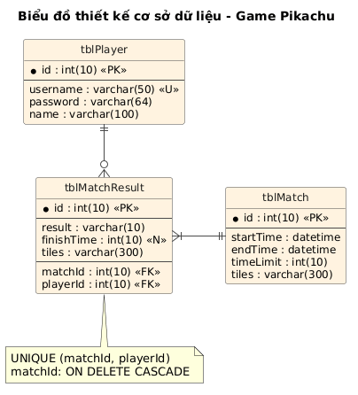

*Hình 3.2: Biểu đồ thiết kế cơ sở dữ liệu*

| Bảng | Cột | Ghi chú |
|---|---|---|
| `tblPlayer` | `id`, `username`, `password`, `name` | `username` duy nhất; `password` là chuỗi băm SHA-256 dạng hex (64 ký tự) |
| `tblMatch` | `id`, `startTime`, `endTime`, `timeLimit`, `tiles` | `tiles` là đề bài ban đầu của ván |
| `tblMatchResult` | `id`, `result`, `finishTime`, `tiles`, `matchId`, `playerId` | `finishTime` rỗng nếu người chơi chưa xóa hết ô; `tiles` là bàn của người chơi lúc ván kết thúc (toàn ô trống nếu đã xóa hết); (`matchId`, `playerId`) duy nhất; xóa ván thì xóa kết quả |

## 3. Kiến trúc và nguyên tắc chuyển từ phân tích sang thiết kế

Hệ thống gồm ba thành phần (module Gradle):

- `app`: client Android. Tầng giao diện là các `Activity`, `Dialog` và lớp vẽ bàn chơi `BoardView`; tầng mạng gồm `ServerConnection` (giữ kết nối TCP, gửi message, nhận message trên một luồng nền rồi chuyển về luồng giao diện cho các `MessageListener`) và `ClientSession` (giữ người chơi đang đăng nhập, tương tự phiên làm việc).
- `server`: Java thuần. `GameServer` mở `ServerSocket`; mỗi client có một `ClientHandler` chạy trên một luồng riêng, đọc từng dòng JSON và chuyển cho lớp điều khiển theo loại message. Lớp điều khiển gọi DAO để đọc ghi CSDL.
- `core`: Java thuần, dùng chung cho cả hai bên: lớp thực thể, các lớp xử lý bàn chơi (`PathFinder`, `BoardGenerator`, `Bot`) và lớp message `Message`.

Client không bao giờ gọi DAO trực tiếp: giữa giao diện và DAO luôn có tầng mạng và lớp điều khiển trên server. Server là trọng tài: mọi nước đi trong ván đối kháng được server kiểm tra lại bằng `PathFinder` trên bản bàn chơi của chính người gửi.

Các phương thức của lớp thực thể ở pha phân tích được chuyển sang thiết kế như sau:

| Phương thức pha phân tích | Lớp thiết kế | Lý do |
|---|---|---|
| `Player.checkLogin()` | `PlayerDAO.checkLogin()` | đọc CSDL |
| `PlayerRanking.getRanking()`, `getTotalPoints()` | `PlayerRankingDAO` | truy vấn thống kê trên CSDL |
| `Match.saveMatch()` | `MatchDAO.saveMatch()` | ghi CSDL |
| `Player.getOnlinePlayers()`, `sendInvitation()`, `updateStatus()` | `OnlinePlayerManager` (server) | danh sách online, lời mời, trạng thái chỉ nằm trong bộ nhớ server, không có trong CSDL, nên giao cho một lớp quản lý trong bộ nhớ thay cho DAO |
| `Match.createMatch()` | `MatchManager.createMatch()` (server) | ván đang diễn ra chỉ nằm trong bộ nhớ server cho tới khi kết thúc mới được lưu |
| `Board.checkPath()`, `findAvailablePair()` | `PathFinder` (core) | thuật toán dùng chung cho client (chơi với máy) và server (trọng tài); tách khỏi lớp dữ liệu `Board` |
| `Board.generateBoard()`, `shuffle()` | `BoardGenerator` (core) | như trên |
| `Board.removePair()`, `isCleared()` | giữ ở `Board` | chỉ thao tác trên dữ liệu của chính bàn chơi |

Tên phương thức được giữ nguyên như pha phân tích để truy vết được từ biểu đồ lớp phân tích tới biểu đồ lớp thiết kế.

## 4. Thiết kế tĩnh cho ba modul

Màu trong các biểu đồ lớp thiết kế: xanh dương là tầng giao diện client, tím là tầng mạng client, xanh lá là tầng điều khiển (trên server, hoặc lớp xử lý của `core`), vàng là tầng DAO, cam là lớp thực thể và lớp message của `core`. Thuộc tính của lớp giao diện là các thành phần giao diện Android (`EditText`, `TextView`, `Button`, `RecyclerView`...) và các thuộc tính ẩn giữ dữ liệu cần cho xử lý.

### a. Modul xem bảng xếp hạng

Giao diện gồm ba màn hình, nối theo luồng như Hình 3.3.


*Hình 3.3: Thiết kế giao diện modul xem bảng xếp hạng*

- `LoginScreen` → `LoginActivity`: hai `EditText` nhập tên đăng nhập và mật khẩu, `TextView` báo lỗi, nút Đăng nhập. `LoginActivity` cài đặt `MessageListener` để nhận `LOGIN_RESULT`.
- `MainScreen` → `MainActivity`: `RecyclerView` danh sách người chơi online, các nút Xem bảng xếp hạng, Chơi với máy, Đăng xuất; thuộc tính ẩn `player` là người chơi đang đăng nhập, lấy từ `ClientSession`.
- `RankingScreen` → `RankingActivity`: `RecyclerView` bảng xếp hạng, nút Quay lại; thuộc tính ẩn `listRanking`.
- Trên server, `LoginController.handleLogin()` gọi `PlayerDAO.checkLogin()` rồi `OnlinePlayerManager.addOnlinePlayer()`; hàm này trả về sai nếu tài khoản đang online ở máy khác (ngoại lệ 2b). `RankingController.handleGetRanking()` gọi `PlayerRankingDAO.getRanking()`.
- `PlayerDAO`, `PlayerRankingDAO` kế thừa lớp `DAO` để dùng chung một kết nối CSDL.


*Hình 3.4: Biểu đồ lớp thiết kế modul xem bảng xếp hạng*

### b. Modul chơi với máy

Ván với máy chạy hoàn toàn trên client và không lưu kết quả; client chỉ báo server trạng thái luyện tập (`UPDATE_STATUS`) để người khác vẫn thấy mình online. Giao diện như Hình 3.5 (màn hình ngang).

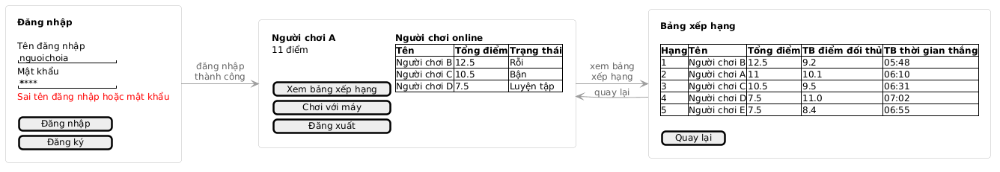

*Hình 3.5: Thiết kế giao diện modul chơi với máy*

- `DifficultyScreen` → `DifficultyActivity`: ba thẻ chọn độ khó (chỉ có hình và tên độ khó), nút Bắt đầu, nút Quay lại.
- `BotGameScreen` → `BotGameActivity` và lớp vẽ `BoardView`. `BoardView` là một `View` tự vẽ: vẽ các ô hình, ô đang chọn và đường nối, nhận sự kiện chạm rồi gọi `BotGameActivity.onCellClick()`. `BotGameActivity` giữ các thuộc tính ẩn: bàn của người chơi `board`, bàn của máy `botBoard` (bản sao cùng đề), đối tượng `bot`, ô đã chọn trước `firstCell`, đồng hồ `timer` và `handler` để hẹn lượt của máy. Màn chơi có hai `BoardView`: bàn của người chơi ở giữa, bàn của máy thu nhỏ ở bên phải (`botBoardView`, chỉ để xem, `setInteractive(false)`); mỗi nước của máy được vẽ lên bàn thu nhỏ cùng hiệu ứng nối cặp.
- Chế độ chơi solo (mở rộng của modul này): cùng `BotGameActivity` nhưng không có máy (không truyền độ khó); người chơi tự xóa hết bàn trong 10 phút, hết giờ thì báo hết giờ. Cột bên phải thay bàn của máy bằng bảng chế độ solo. Solo chơi được cả khi chưa đăng nhập (nút Chơi solo offline ở màn đăng nhập, không cần server); nếu đã đăng nhập thì trạng thái là luyện tập như khi chơi với máy.
- `BotResultDialog`: `TextView` kết quả, nút OK.
- Lớp xử lý trong `core`: `BoardGenerator` (sinh đề, xáo bàn), `PathFinder` (kiểm tra đường nối, tìm cặp còn nối được), `Bot` (chọn nước đi, thời gian chờ theo độ khó).

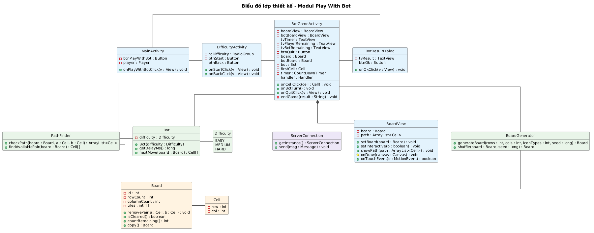

*Hình 3.6: Biểu đồ lớp thiết kế modul chơi với máy*

### c. Modul thách đấu và đấu đối kháng

Giao diện như Hình 3.7. Dialog xác nhận thách đấu hiện trên máy người thách đấu, dialog lời mời hiện trên máy người được mời; các màn hình còn lại hiện trên cả hai máy.


*Hình 3.7: Thiết kế giao diện modul thách đấu và đấu đối kháng*

- `MainScreen` → `MainActivity`: thêm `TextView` thông báo (đang chờ, bị từ chối, đối thủ đã dừng) và xử lý click vào một người chơi trong danh sách: mở `ChallengeConfirmDialog`, chỉ gửi lời mời khi người chơi xác nhận. `MainActivity` nhận `ONLINE_LIST`, `INVITE_RECEIVED`, `INVITE_RESULT`, `MATCH_START`.
- `ChallengeConfirmDialog`: `TextView` tên đối thủ, nút Xác nhận, nút Hủy; thuộc tính ẩn `opponent`. Xác nhận thì trả đối thủ về cho `MainActivity` để gửi `INVITE`; Hủy thì chỉ đóng dialog, không gửi gì lên server.
- `InvitationDialog`: `TextView` tên người mời, nút OK, nút Reject; thuộc tính ẩn `challenger`.
- `MatchScreen` → `MatchActivity`: bàn của mình (`BoardView`), bàn thu nhỏ của đối thủ (`opponentBoardView`, chỉ để xem), đồng hồ, số ô còn lại của hai bên, nút Thoát; thuộc tính ẩn `board`, `opponentBoard`, `matchId`, `opponent`, `firstCell`. Khác với ván với máy, `MatchActivity` không tự kiểm tra đường nối mà gửi `MOVE` lên server rồi cập nhật bàn theo `MOVE_RESULT`, thay bàn khi nhận `BOARD_SHUFFLED`; bàn của đối thủ được cập nhật theo `OPPONENT_PROGRESS` (cặp vừa xóa, đường nối và cả bàn hiện tại của đối thủ, gồm cả khi bàn đó vừa được xáo).
- `ResultDialog`: `TextView` kết quả, nút Tiếp tục, nút Dừng; nhận `OPPONENT_LEFT` khi đối thủ dừng.
- Trên server:
  - `ChallengeController` xử lý `INVITE`, `INVITE_REPLY` và gửi lại danh sách online (`broadcastOnlineList()`).
  - `MatchController` xử lý `MOVE`, `LEAVE_MATCH`, `REMATCH_REPLY`, hết giờ (`onTimeout()`), và kết thúc ván (`endMatch()`).
  - `MatchManager` giữ các ván đang diễn ra; mỗi ván là một `MatchRoom` gồm `Match`, hai `ClientHandler`, **hai bản bàn chơi riêng** cho hai người (cùng đề ban đầu), thời điểm bắt đầu theo đồng hồ server và bộ hẹn giờ 10 phút.
  - `OnlinePlayerManager` giữ ánh xạ tên đăng nhập → `ClientHandler` của người đang online và trạng thái (rỗi, luyện tập, bận).
- Các thao tác trên `MatchRoom` được đồng bộ (`synchronized`) vì hai luồng `ClientHandler` của hai người chơi cùng truy cập một phòng; ai hoàn thành trước được xác định theo thứ tự server xử lý message.


*Hình 3.8: Biểu đồ lớp thiết kế modul thách đấu và đấu đối kháng*

## 5. Thiết kế hoạt động cho ba modul

Mỗi hành động trong biểu đồ hoạt động ứng với một phương thức đã thiết kế ở mục 4; phương thức của lớp DAO, lớp quản lý và lớp xử lý được ghi ở ghi chú bên cạnh. Trong kịch bản phiên bản 3 và biểu đồ tuần tự, các bước gán từng thuộc tính khi đóng gói lớp thực thể được lược bỏ cho gọn. Tên hành động là tên phương thức đã thiết kế; khung kích hoạt thể hiện phạm vi hoạt động của từng phương thức.

### a. Modul xem bảng xếp hạng


*Hình 3.9: Biểu đồ hoạt động modul xem bảng xếp hạng*

Kịch bản phiên bản 3:

<!-- BEGIN v3-m1 -->
1. Tại giao diện `LoginActivity`, người chơi nhập tên đăng nhập, mật khẩu và click nút Đăng nhập.
2. Lớp `LoginActivity` gọi lớp `ServerConnection` yêu cầu gửi message `LOGIN`.
3. Lớp `ServerConnection` gửi message `LOGIN` qua TCP tới lớp `ClientHandler` trên server.
4. Lớp `ClientHandler` gọi hàm `handleLogin()` của lớp `LoginController`.
5. Lớp `LoginController` gọi lớp `PlayerDAO` yêu cầu kiểm tra đăng nhập.
6. Lớp `PlayerDAO` gọi hàm `checkLogin()`.
7. Hàm `checkLogin()` gọi lớp `Player` để đóng gói thông tin.
8. Lớp `Player` đóng gói thông tin thực thể.
9. Lớp `Player` trả kết quả cho hàm `checkLogin()`.
10. Hàm `checkLogin()` trả kết quả cho lớp `LoginController`.
11. Lớp `LoginController` gọi lớp `OnlinePlayerManager` yêu cầu thêm người chơi vào danh sách online.
12. Lớp `OnlinePlayerManager` gọi hàm `addOnlinePlayer()`.
13. Hàm `addOnlinePlayer()` trả kết quả cho lớp `LoginController`.
14. Lớp `LoginController` gọi lớp `ClientHandler` gửi message `LOGIN_RESULT`.
15. Lớp `ClientHandler` gửi message `LOGIN_RESULT` qua TCP tới lớp `ServerConnection`.
16. Lớp `ServerConnection` chuyển message cho lớp `LoginActivity`.
17. Lớp `LoginActivity` lưu người chơi vào `ClientSession` và gọi lớp `MainActivity`.
18. Lớp `MainActivity` hiển thị giao diện chính cho người chơi.
19. Người chơi click nút Xem bảng xếp hạng.
20. Lớp `MainActivity` gọi lớp `RankingActivity`.
21. Lớp `RankingActivity` gọi lớp `ServerConnection` yêu cầu gửi message `GET_RANKING`.
22. Lớp `ServerConnection` gửi message `GET_RANKING` qua TCP tới lớp `ClientHandler`.
23. Lớp `ClientHandler` gọi hàm `handleGetRanking()` của lớp `RankingController`.
24. Lớp `RankingController` gọi lớp `PlayerRankingDAO` yêu cầu lấy bảng xếp hạng.
25. Lớp `PlayerRankingDAO` gọi hàm `getRanking()`.
26. Hàm `getRanking()` gọi lớp `PlayerRanking` để đóng gói thông tin.
27. Lớp `PlayerRanking` đóng gói thông tin thực thể.
28. Lớp `PlayerRanking` trả kết quả cho hàm `getRanking()`.
29. Hàm `getRanking()` trả danh sách đã sắp xếp cho lớp `RankingController`.
30. Lớp `RankingController` gọi lớp `ClientHandler` gửi message `RANKING`.
31. Lớp `ClientHandler` gửi message `RANKING` qua TCP tới lớp `ServerConnection`.
32. Lớp `ServerConnection` chuyển message cho lớp `RankingActivity`.
33. Lớp `RankingActivity` hiển thị bảng xếp hạng cho người chơi.
34. Người chơi click nút Quay lại.
35. Lớp `RankingActivity` gọi lại lớp `MainActivity`.
36. Lớp `MainActivity` hiển thị giao diện chính cho người chơi.
<!-- END v3-m1 -->


*Hình 3.10: Biểu đồ tuần tự modul xem bảng xếp hạng*

### b. Modul chơi với máy

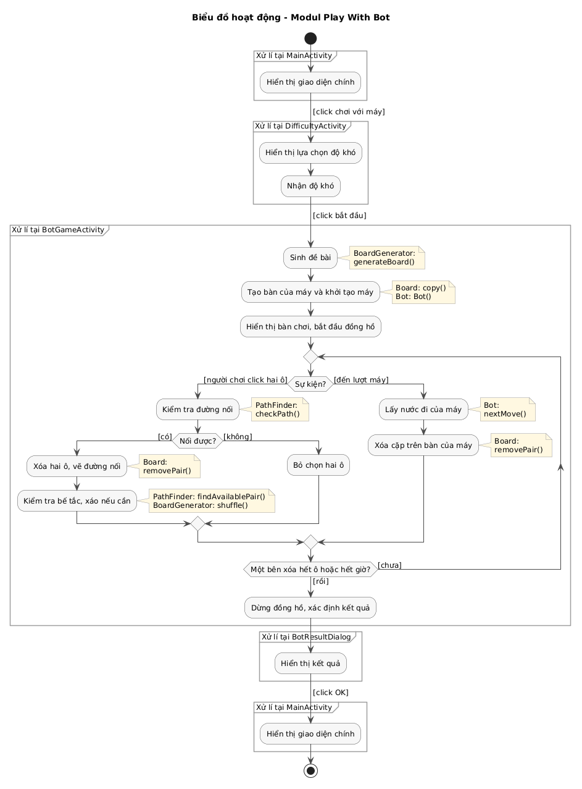

*Hình 3.11: Biểu đồ hoạt động modul chơi với máy*

Kịch bản phiên bản 3:

<!-- BEGIN v3-m2 -->
1. Tại giao diện chính, người chơi click nút Chơi với máy.
2. Lớp `MainActivity` gọi lớp `DifficultyActivity`.
3. Lớp `DifficultyActivity` hiển thị các lựa chọn độ khó cho người chơi.
4. Người chơi chọn độ khó Trung bình và click nút Bắt đầu.
5. Lớp `DifficultyActivity` gọi lớp `BotGameActivity`, kèm độ khó đã chọn.
6. Lớp `BotGameActivity` gọi lớp `BoardGenerator` yêu cầu sinh đề bài 10x10.
7. Lớp `BoardGenerator` gọi hàm `generateBoard()`.
8. Hàm `generateBoard()` gọi lớp `Board` để đóng gói đề bài.
9. Lớp `Board` đóng gói thông tin thực thể.
10. Lớp `Board` trả kết quả cho hàm `generateBoard()`.
11. Hàm `generateBoard()` trả đề bài cho lớp `BotGameActivity`.
12. Lớp `BotGameActivity` gọi lớp `Board` yêu cầu tạo bản sao đề bài cho máy.
13. Lớp `Board` gọi hàm `copy()`.
14. Hàm `copy()` trả bàn của máy cho lớp `BotGameActivity`.
15. Lớp `BotGameActivity` gọi lớp `Bot` yêu cầu khởi tạo máy theo độ khó.
16. Lớp `Bot` gọi hàm khởi tạo `Bot()`.
17. Lớp `Bot` trả đối tượng máy cho lớp `BotGameActivity`.
18. Lớp `BotGameActivity` gọi hàm `setBoard()` của lớp `BoardView` và bắt đầu đồng hồ.
19. Lớp `BoardView` hiển thị bàn chơi, đồng hồ và số ô còn lại cho người chơi.
20. Người chơi click lần lượt hai ô cùng hình.
21. Lớp `BoardView` gọi hàm `onCellClick()` của lớp `BotGameActivity`.
22. Lớp `BotGameActivity` gọi lớp `PathFinder` yêu cầu kiểm tra đường nối giữa hai ô.
23. Lớp `PathFinder` gọi hàm `checkPath()`.
24. Hàm `checkPath()` trả đường nối cho lớp `BotGameActivity`.
25. Lớp `BotGameActivity` gọi lớp `Board` yêu cầu xóa hai ô.
26. Lớp `Board` gọi hàm `removePair()`.
27. Hàm `removePair()` trả kết quả cho lớp `BotGameActivity`.
28. Lớp `BotGameActivity` gọi lớp `Board` yêu cầu kiểm tra bàn đã hết ô chưa.
29. Lớp `Board` gọi hàm `isCleared()`.
30. Hàm `isCleared()` trả kết quả cho lớp `BotGameActivity`.
31. Lớp `BotGameActivity` gọi lớp `PathFinder` yêu cầu tìm một cặp còn nối được để kiểm tra bế tắc.
32. Lớp `PathFinder` gọi hàm `findAvailablePair()`.
33. Hàm `findAvailablePair()` trả cặp ô cho lớp `BotGameActivity` (nếu trả về rỗng thì lớp `BotGameActivity` gọi `BoardGenerator.shuffle()` để xáo bàn).
34. Lớp `BotGameActivity` gọi hàm `showPath()` của lớp `BoardView`.
35. Lớp `BoardView` vẽ đường nối, hiển thị bàn chơi mới và số ô còn lại cho người chơi.
36. Sau mỗi khoảng `getDelayMs()`, lớp `BotGameActivity` gọi lớp `Bot` yêu cầu nước đi của máy.
37. Lớp `Bot` gọi hàm `nextMove()`.
38. Hàm `nextMove()` gọi lớp `PathFinder` yêu cầu tìm một cặp nối được trên bàn của máy.
39. Lớp `PathFinder` gọi hàm `findAvailablePair()`.
40. Hàm `findAvailablePair()` trả cặp ô cho hàm `nextMove()`.
41. Hàm `nextMove()` trả nước đi cho lớp `BotGameActivity`.
42. Lớp `BotGameActivity` gọi lớp `Board` của máy yêu cầu xóa cặp ô đó.
43. Lớp `Board` gọi hàm `removePair()`.
44. Hàm `removePair()` trả kết quả cho lớp `BotGameActivity`.
45. Lớp `BotGameActivity` vẽ nước đi của máy lên bàn thu nhỏ của máy và hiển thị số ô còn lại của máy cho người chơi.
(Lặp lại các bước 20 đến 45 cho đến khi một bên xóa hết ô hoặc hết giờ.)
46. Lớp `BotGameActivity` dừng đồng hồ, xác định kết quả và gọi lớp `BotResultDialog`.
47. Lớp `BotResultDialog` hiển thị kết quả ván cho người chơi.
48. Người chơi click nút OK.
49. Lớp `BotResultDialog` gọi lại lớp `MainActivity`.
50. Lớp `MainActivity` hiển thị giao diện chính cho người chơi.
<!-- END v3-m2 -->

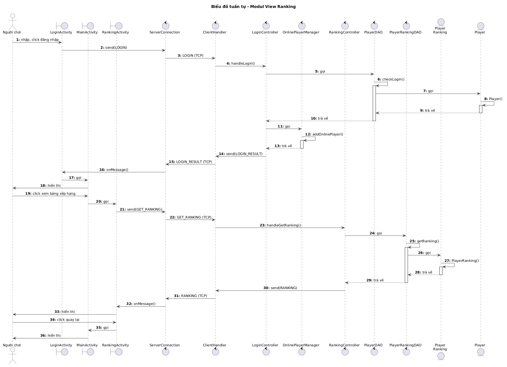

*Hình 3.12: Biểu đồ tuần tự modul chơi với máy*

### c. Modul thách đấu và đấu đối kháng


*Hình 3.13: Biểu đồ hoạt động modul thách đấu và đấu đối kháng*

Kịch bản phiên bản 3 (người chơi A thách đấu người chơi B; mỗi lớp giao diện và `ServerConnection` có một bản trên mỗi máy, mỗi người chơi có một `ClientHandler` riêng trên server):

<!-- BEGIN v3-m3 -->
1. Tại giao diện chính, người chơi A click vào tên người chơi B đang rỗi.
2. Lớp `MainActivity` gọi lớp `ChallengeConfirmDialog`.
3. Lớp `ChallengeConfirmDialog` hiển thị dialog xác nhận thách đấu B cho A.
4. A click nút Xác nhận.
5. Lớp `ChallengeConfirmDialog` trả kết quả xác nhận cho lớp `MainActivity`.
6. Lớp `MainActivity` gọi lớp `ServerConnection` yêu cầu gửi message `INVITE`.
7. Lớp `MainActivity` hiển thị thông báo đang chờ B trả lời cho A.
8. Lớp `ServerConnection` gửi message `INVITE` qua TCP tới lớp `ClientHandler` của A trên server.
9. Lớp `ClientHandler` gọi hàm `handleInvite()` của lớp `ChallengeController`.
10. Lớp `ChallengeController` gọi lớp `OnlinePlayerManager` yêu cầu gửi lời mời từ A tới B.
11. Lớp `OnlinePlayerManager` gọi hàm `sendInvitation()`, kiểm tra B đang online và rỗi.
12. Hàm `sendInvitation()` gọi lớp `ClientHandler` của B gửi message `INVITE_RECEIVED`.
13. Hàm `sendInvitation()` trả kết quả cho lớp `ChallengeController`.
14. Lớp `ClientHandler` của B gửi message `INVITE_RECEIVED` qua TCP tới lớp `ServerConnection` trên máy B.
15. Lớp `ServerConnection` chuyển message cho lớp `MainActivity` trên máy B.
16. Lớp `MainActivity` gọi lớp `InvitationDialog`.
17. Lớp `InvitationDialog` hiển thị lời mời cho B.
18. B click nút OK.
19. Lớp `InvitationDialog` gọi lớp `ServerConnection` yêu cầu gửi message `INVITE_REPLY` chấp nhận.
20. Lớp `ServerConnection` gửi message `INVITE_REPLY` qua TCP tới lớp `ClientHandler` của B.
21. Lớp `ClientHandler` gọi hàm `handleInviteReply()` của lớp `ChallengeController`.
22. Lớp `ChallengeController` gọi lớp `BoardGenerator` yêu cầu sinh đề bài 10x10.
23. Lớp `BoardGenerator` gọi hàm `generateBoard()`.
24. Hàm `generateBoard()` gọi lớp `Board` để đóng gói đề bài.
25. Lớp `Board` đóng gói thông tin thực thể.
26. Lớp `Board` trả kết quả cho hàm `generateBoard()`.
27. Hàm `generateBoard()` trả đề bài cho lớp `ChallengeController`.
28. Lớp `ChallengeController` gọi lớp `MatchManager` yêu cầu tạo ván đấu cho A và B với đề bài vừa sinh.
29. Lớp `MatchManager` gọi hàm `createMatch()`, tạo phòng chơi giữ hai bản sao đề bài cho hai người.
30. Hàm `createMatch()` gọi lớp `Match` để đóng gói ván đấu.
31. Lớp `Match` đóng gói thông tin thực thể.
32. Lớp `Match` trả kết quả cho hàm `createMatch()`.
33. Hàm `createMatch()` trả phòng chơi cho lớp `ChallengeController`.
34. Lớp `ChallengeController` gọi lớp `OnlinePlayerManager` yêu cầu chuyển A và B sang bận.
35. Lớp `OnlinePlayerManager` gọi hàm `updateStatus()`.
36. Hàm `updateStatus()` trả kết quả cho lớp `ChallengeController`.
37. Lớp `ChallengeController` gọi lớp `ClientHandler` của A và của B gửi message `MATCH_START`.
38. Lớp `ClientHandler` gửi message `MATCH_START` qua TCP tới lớp `ServerConnection` trên cả hai máy.
39. Lớp `ServerConnection` chuyển message cho lớp `MainActivity` trên cả hai máy.
40. Lớp `MainActivity` gọi lớp `MatchActivity`, kèm đề bài và thông tin đối thủ.
41. Lớp `MatchActivity` hiển thị bàn chơi, đồng hồ và số ô còn lại của đối thủ cho A và B.
42. A click lần lượt hai ô cùng hình.
43. Lớp `MatchActivity` gọi lớp `ServerConnection` yêu cầu gửi message `MOVE`.
44. Lớp `ServerConnection` gửi message `MOVE` qua TCP tới lớp `ClientHandler` của A.
45. Lớp `ClientHandler` gọi hàm `handleMove()` của lớp `MatchController`.
46. Lớp `MatchController` gọi lớp `MatchManager` yêu cầu lấy phòng chơi của ván.
47. Lớp `MatchManager` gọi hàm `getRoom()`.
48. Hàm `getRoom()` trả phòng chơi cho lớp `MatchController`, từ đó lấy bàn của A.
49. Lớp `MatchController` gọi lớp `PathFinder` yêu cầu kiểm tra đường nối trên bàn của A.
50. Lớp `PathFinder` gọi hàm `checkPath()`.
51. Hàm `checkPath()` trả đường nối cho lớp `MatchController`.
52. Lớp `MatchController` gọi lớp `Board` của A yêu cầu xóa hai ô.
53. Lớp `Board` gọi hàm `removePair()`.
54. Hàm `removePair()` trả kết quả cho lớp `MatchController`.
55. Lớp `MatchController` gọi lớp `Board` yêu cầu kiểm tra bàn của A đã hết ô chưa.
56. Lớp `Board` gọi hàm `isCleared()`.
57. Hàm `isCleared()` trả kết quả cho lớp `MatchController`.
58. Lớp `MatchController` gọi lớp `PathFinder` yêu cầu tìm một cặp còn nối được trên bàn của A để kiểm tra bế tắc.
59. Lớp `PathFinder` gọi hàm `findAvailablePair()`.
60. Hàm `findAvailablePair()` trả cặp ô cho lớp `MatchController` (nếu trả về rỗng thì lớp `MatchController` gọi `BoardGenerator.shuffle()` xáo riêng bàn của A và gửi `BOARD_SHUFFLED` cho A).
61. Lớp `MatchController` gọi lớp `ClientHandler` của A gửi message `MOVE_RESULT` và lớp `ClientHandler` của B gửi message `OPPONENT_PROGRESS`.
62. Lớp `ClientHandler` gửi các message qua TCP tới lớp `ServerConnection` trên hai máy.
63. Lớp `ServerConnection` chuyển message cho lớp `MatchActivity` trên hai máy.
64. Lớp `MatchActivity` vẽ đường nối và bàn chơi mới cho A; trên máy B, vẽ nước đi của A lên bàn thu nhỏ của đối thủ và cập nhật số ô còn lại của A.
(Lặp lại các bước 42 đến 64 cho đến khi bước 57 trả về bàn của A đã hết ô; B chơi song song theo cùng các bước trên máy của mình.)
65. Khi bàn của A đã hết ô, lớp `MatchController` gọi hàm `endMatch()`, tính kết quả và điểm của hai người.
66. Hàm `endMatch()` gọi lớp `MatchDAO` yêu cầu lưu ván đấu cùng hai kết quả.
67. Lớp `MatchDAO` gọi hàm `saveMatch()`.
68. Hàm `saveMatch()` trả kết quả cho hàm `endMatch()`.
69. Hàm `endMatch()` gọi lớp `ClientHandler` của A và của B gửi message `MATCH_END`.
70. Lớp `ClientHandler` gửi message `MATCH_END` qua TCP tới lớp `ServerConnection` trên hai máy.
71. Lớp `ServerConnection` chuyển message cho lớp `MatchActivity` trên hai máy.
72. Lớp `MatchActivity` gọi lớp `ResultDialog`.
73. Lớp `ResultDialog` hiển thị kết quả và câu hỏi có muốn tiếp tục không cho A và B.
74. A click nút Dừng.
75. Lớp `ResultDialog` gọi lớp `ServerConnection` yêu cầu gửi message `REMATCH_REPLY` từ chối.
76. Lớp `ResultDialog` gọi lớp `MainActivity` trên máy A.
77. Lớp `ServerConnection` gửi message `REMATCH_REPLY` qua TCP tới lớp `ClientHandler` của A.
78. Lớp `ClientHandler` gọi hàm `handleRematchReply()` của lớp `MatchController`.
79. Lớp `MatchController` gọi lớp `OnlinePlayerManager` yêu cầu chuyển A và B về rỗi.
80. Lớp `OnlinePlayerManager` gọi hàm `updateStatus()`.
81. Hàm `updateStatus()` trả kết quả cho lớp `MatchController`.
82. Lớp `MatchController` gọi lớp `ClientHandler` của B gửi message `OPPONENT_LEFT`.
83. Lớp `MatchController` gọi lớp `ChallengeController` yêu cầu gửi lại danh sách người chơi online.
84. Lớp `ChallengeController` gọi hàm `broadcastOnlineList()`.
85. Hàm `broadcastOnlineList()` gọi lớp `OnlinePlayerManager` yêu cầu lấy danh sách người chơi online.
86. Lớp `OnlinePlayerManager` gọi hàm `getOnlinePlayers()`.
87. Hàm `getOnlinePlayers()` trả danh sách cho hàm `broadcastOnlineList()`.
88. Hàm `broadcastOnlineList()` gọi lớp `PlayerRankingDAO` yêu cầu lấy tổng điểm của các người chơi trong danh sách.
89. Lớp `PlayerRankingDAO` gọi hàm `getTotalPoints()`.
90. Hàm `getTotalPoints()` gọi lớp `PlayerRanking` để đóng gói thông tin.
91. Lớp `PlayerRanking` đóng gói thông tin thực thể.
92. Lớp `PlayerRanking` trả kết quả cho hàm `getTotalPoints()`.
93. Hàm `getTotalPoints()` trả kết quả cho hàm `broadcastOnlineList()`.
94. Hàm `broadcastOnlineList()` gọi lớp `ClientHandler` của mọi người chơi rỗi gửi message `ONLINE_LIST`.
95. Lớp `ClientHandler` gửi các message qua TCP tới lớp `ServerConnection` trên hai máy.
96. Lớp `ServerConnection` chuyển message `OPPONENT_LEFT` cho lớp `ResultDialog` trên máy B.
97. Lớp `ResultDialog` gọi lớp `MainActivity` trên máy B.
98. Lớp `ServerConnection` chuyển message `ONLINE_LIST` cho lớp `MainActivity` trên hai máy.
99. Lớp `MainActivity` hiển thị danh sách người chơi online đã cập nhật điểm cho A và B, kèm thông báo "A đã dừng chơi" cho B.
<!-- END v3-m3 -->

Biểu đồ tuần tự được chia làm hai phần: phần 1 từ lúc thách đấu tới khi ván bắt đầu (Hình 3.14), phần 2 từ lúc chơi tới khi về giao diện chính (Hình 3.15).

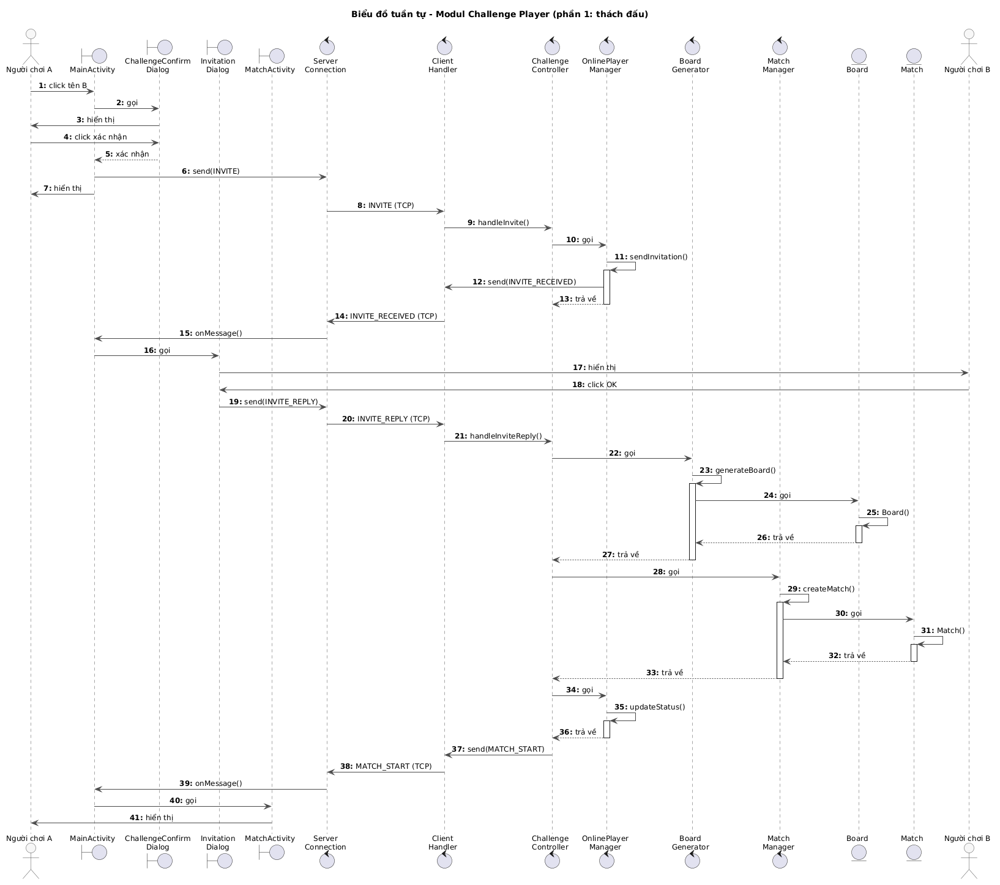

*Hình 3.14: Biểu đồ tuần tự modul thách đấu và đấu đối kháng, phần 1*

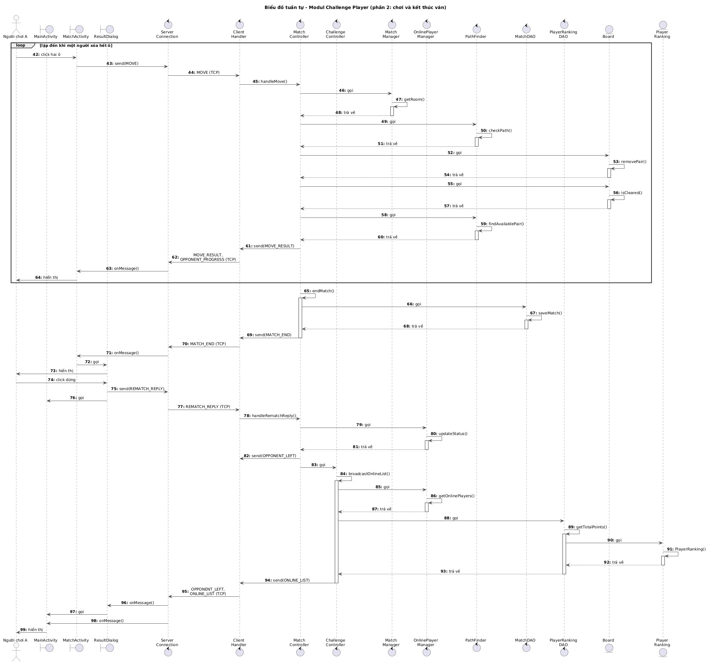

*Hình 3.15: Biểu đồ tuần tự modul thách đấu và đấu đối kháng, phần 2*

## 6. Thiết kế triển khai

Các lớp được chia vào gói theo tầng: phía client là `view` và `network`; phía server là `controller` và `dao`; phần dùng chung `core` gồm `model` (lớp thực thể), `logic` (xử lý bàn chơi) và `protocol` (message). Gói gốc là `ptit.e23cnpm01.pikachu`. Biểu đồ gói như Hình 3.16.

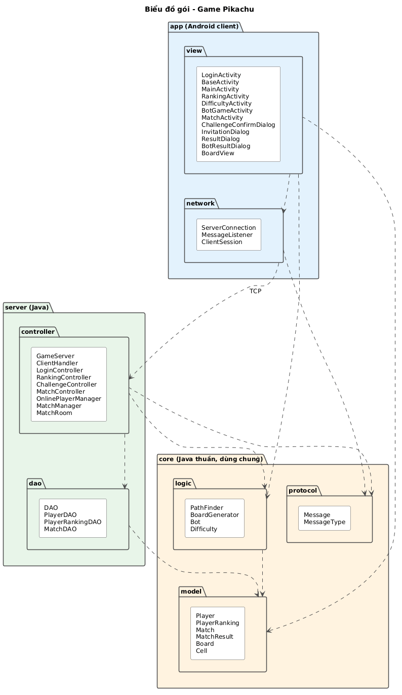

*Hình 3.16: Biểu đồ gói*

Mỗi người chơi cài ứng dụng trên một thiết bị Android; các thiết bị kết nối tới máy chủ game qua TCP; máy chủ game truy cập CSDL qua JDBC. Biểu đồ triển khai như Hình 3.17.

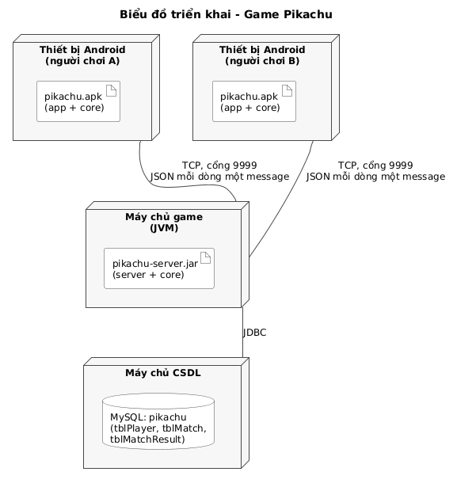

*Hình 3.17: Biểu đồ triển khai*

## 7. Thiết kế giao thức truyền thông

- Dùng TCP thay vì UDP: game theo lượt click, không cần tốc độ khung hình cao, nhưng không được mất hay đảo thứ tự nước đi và kết quả ván. TCP bảo đảm cả hai điều này.
- Mỗi message là một đối tượng JSON nằm trên một dòng (kết thúc bằng ký tự xuống dòng), trường `type` cho biết loại message, các trường còn lại là dữ liệu. Ví dụ: `{"type":"MOVE","matchId":12,"a":{"row":3,"col":5},"b":{"row":7,"col":2}}`. Lớp `Message` trong `core` chuyển đổi giữa đối tượng và chuỗi JSON (thư viện Gson) để client và server dùng chung một định dạng.
- Server tự đẩy `ONLINE_LIST` cho mọi client đang rỗi mỗi khi có thay đổi (đăng nhập, đăng xuất, đổi trạng thái, đổi điểm), nên client không phải hỏi định kỳ.
- Toạ độ ô trong message là toạ độ trên lưới 12x12 có viền.

| Chiều | `type` | Nội dung chính |
|---|---|---|
| C → S | `REGISTER` | `username`, `password`, `name` |
| S → C | `REGISTER_RESULT` | `ok`, `error` |
| C → S | `LOGIN` | `username`, `password` |
| S → C | `LOGIN_RESULT` | `ok`, `error`, `player` |
| C → S | `LOGOUT` | |
| C → S | `UPDATE_STATUS` | `status`: `TRAINING` khi vào chơi với máy hoặc solo, `IDLE` khi thôi; server bỏ qua nếu đang `BUSY` |
| S → C | `ONLINE_LIST` | danh sách `PlayerRanking` (thuộc tính kế thừa từ `Player`: `username`, `name`, `status` là `IDLE`, `TRAINING` hoặc `BUSY`; thêm `totalPoint`) |
| C → S | `GET_RANKING` | |
| S → C | `RANKING` | danh sách `{rank, name, totalPoint, avgOpponentPoint, avgWinTime}` |
| C → S | `INVITE` | `to` |
| S → C | `INVITE_RECEIVED` | `from` |
| C → S | `INVITE_REPLY` | `from`, `accept` |
| S → C | `INVITE_RESULT` | `to`, `accepted`, `reason` (`REJECTED`, `BUSY`, `OFFLINE`; `EXPIRED` gửi cho người được mời khi lời mời đã hết hiệu lực) |
| S → C | `MATCH_START` | `matchId`, `tiles`, `timeLimitSec`, `opponent` |
| C → S | `MOVE` | `matchId`, `a`, `b` |
| S → C | `MOVE_RESULT` | `ok`, `path`, `remaining` |
| S → C | `BOARD_SHUFFLED` | `tiles` (chỉ gửi cho người có bàn bị bế tắc) |
| S → C | `OPPONENT_PROGRESS` | `remaining`, `a`, `b`, `path` (nước đối thủ vừa đi), `tiles` (bàn hiện tại của đối thủ), `shuffled` (bàn đối thủ vừa được xáo) |
| C → S | `LEAVE_MATCH` | `matchId` |
| S → C | `MATCH_END` | `result`, `point`, `finishTime` và `remaining` của hai bên, `reason` (`CLEARED`, `TIMEOUT`, `QUIT`, `DISCONNECT`) |
| C → S | `REMATCH_REPLY` | `matchId`, `accept` |
| S → C | `OPPONENT_LEFT` | |

Luồng message chính giữa hai client và server như Hình 3.18.

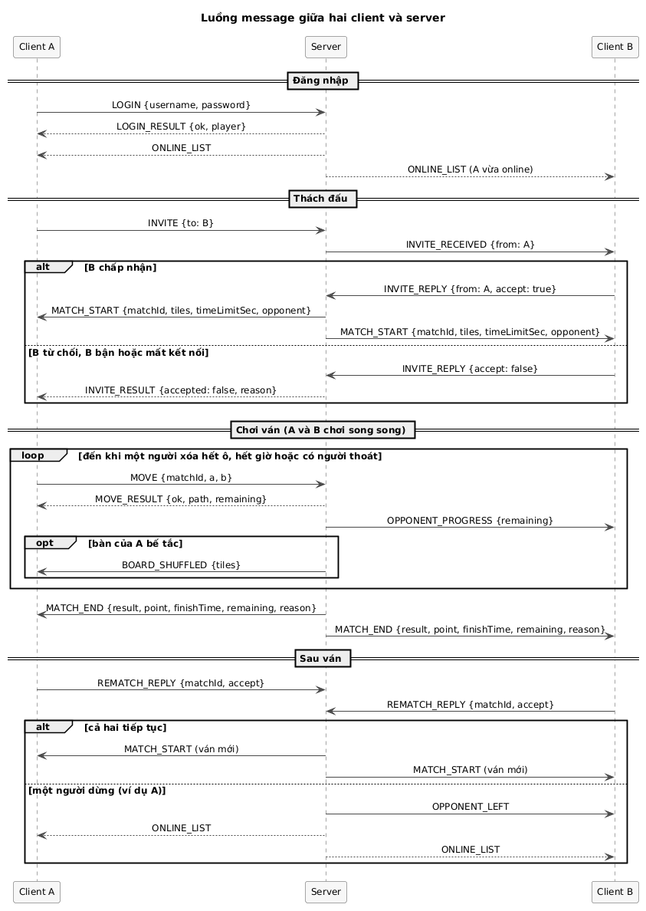

*Hình 3.18: Luồng message giữa hai client và server*

Xử lý các tình huống bất thường:

- Mất kết nối giữa ván (luồng `ClientHandler` gặp lỗi đọc): server coi như người đó thoát, kết thúc ván với lý do `DISCONNECT`, người còn lại thắng.
- Mất kết nối khi đang có lời mời chờ: server gửi `INVITE_RESULT` với `reason = OFFLINE` cho người mời (đề xuất, `plan.md` §8).
- Mất kết nối khi đang ở dialog tiếp tục: coi như chọn Dừng, gửi `OPPONENT_LEFT` cho người còn lại.
- Hết giờ: bộ hẹn giờ của `MatchRoom` gọi `MatchController.onTimeout()`, kết thúc ván hòa với lý do `TIMEOUT`.

## 8. Thuật toán

### a. Kiểm tra đường nối hai ô

Hai ô nối được khi cùng hình và có một đường gồm tối đa 3 đoạn thẳng (tối đa 2 lần rẽ) đi theo hàng, cột, chỉ qua các ô trống; đường được phép đi trên vòng viền trống của lưới 12x12. Các dạng đường hợp lệ và một ví dụ không hợp lệ như Hình 3.19.


*Hình 3.19: Các dạng đường nối hai ô*

`PathFinder.checkPath()` dùng tìm kiếm theo chiều rộng, mỗi trạng thái là một ô kèm hướng đi và số đoạn đã dùng. Từ mỗi trạng thái, thuật toán đi thẳng theo từng hướng qua các ô trống; đổi hướng thì tăng số đoạn; dừng nhánh khi số đoạn vượt 3, gặp ô có hình, ra khỏi lưới, hoặc ô đó đã được tới bằng số đoạn không lớn hơn.

```text
checkPath(board, a, b):
    nếu a = b hoặc tile(a) = 0 hoặc tile(a) ≠ tile(b): trả về null
    Q ← hàng đợi, thêm (a, hướng = rỗng, số đoạn = 0, đường = [a])
    best[ô][hướng] ← vô cùng
    trong khi Q khác rỗng:
        (c, d, k, path) ← lấy đầu Q
        với mỗi hướng d' trong {lên, xuống, trái, phải}:
            k' ← k nếu d' = d, ngược lại k + 1
            nếu k' > 3: bỏ qua
            n ← c + d'
            trong khi n nằm trong lưới 12x12:
                nếu n = b: trả về rút gọn(path + [n])   // chỉ giữ hai đầu mút và các điểm rẽ
                nếu tile(n) ≠ 0 hoặc best[n][d'] ≤ k': dừng
                best[n][d'] ← k'
                thêm (n, d', k', path + [n]) vào Q
                n ← n + d'
    trả về null
```

Số trạng thái tối đa là 12 x 12 x 4, nên mỗi lần kiểm tra chạy rất nhanh, đáp ứng yêu cầu phản hồi dưới 200 ms của server.

### b. Sinh đề, phát hiện bế tắc và xáo bàn

```text
generateBoard(rows = 10, cols = 10, iconTypes, seed):
    n ← rows x cols / iconTypes                // số ô mỗi loại, phải là số chẵn
    values ← mỗi mã hình 1..iconTypes lặp n lần
    lặp:
        xáo values bằng Random(seed)
        đặt values vào vùng chơi (hàng 1..10, cột 1..10), viền để 0
    đến khi findAvailablePair(board) ≠ null
    trả về board

findAvailablePair(board):
    với mỗi mã hình t, với mỗi cặp ô (p, q) cùng mang hình t:
        nếu checkPath(board, p, q) ≠ null: trả về [p, q]
    trả về null                                // bàn bế tắc

shuffle(board, seed):
    cells ← các ô còn hình; values ← mã hình của các ô đó
    lặp:
        xáo values bằng Random(seed), gán lại vào cells
    đến khi findAvailablePair(board) ≠ null
    trả về board
```

- Với đề xuất 25 loại hình (`plan.md` §8), mỗi loại có 4 ô, nên `findAvailablePair()` xét tối đa 25 x 6 = 150 cặp.
- Sau mỗi lần xóa cặp, bên xử lý (client trong ván với máy, server trong ván đối kháng) gọi `findAvailablePair()`; nếu trả về rỗng mà bàn chưa hết ô thì gọi `shuffle()`.
- Trong ván đối kháng, server sinh đề một lần, sao thành hai bàn riêng cho hai người. Bế tắc xảy ra trên bàn của từng người, nên server chỉ xáo bàn của người bị bế tắc và chỉ gửi `BOARD_SHUFFLED` cho người đó. Seed được server sinh nên client không đoán trước được kết quả xáo.

### c. Máy (bot)

- `getDelayMs()`: thời gian chờ giữa hai nước đi của máy, Dễ 6 giây, Trung bình 4 giây, Khó 2 giây (giá trị ban đầu, chỉnh khi chơi thử).
- `nextMove(board)`: lấy danh sách các cặp còn nối được trên bàn của máy. Mức Dễ và Trung bình chọn ngẫu nhiên một cặp. Mức Khó thử xóa từng cặp trên một bản sao và chọn cặp để lại nhiều cặp nối được nhất, tránh tự làm bàn bế tắc. Nếu không còn cặp nào, `BotGameActivity` xáo bàn của máy rồi đi tiếp.

### d. Kết quả ván và bảng xếp hạng

Kết quả ván do `MatchController.endMatch()` quyết định theo lý do kết thúc:

| Lý do | Người A | Người B |
|---|---|---|
| A xóa hết ô trước (`CLEARED`) | WIN, `finishTime` = thời điểm server nhận nước đi cuối của A trừ thời điểm bắt đầu ván | LOSE, `finishTime` rỗng |
| Hết 10 phút (`TIMEOUT`) | DRAW | DRAW |
| A bấm Thoát (`QUIT`) hoặc mất kết nối (`DISCONNECT`) | LOSE | WIN, `finishTime` rỗng |

Điểm mỗi ván theo đề: thắng 1, hòa 0.5, thua 0. Điểm không lưu trong CSDL mà tính từ `result` ngay trong truy vấn (bảng tạm `r`). Bảng xếp hạng chỉ gồm người chơi đã có ít nhất một ván đối kháng (khớp ngoại lệ 4a của kịch bản), được tính bằng một truy vấn trong `PlayerRankingDAO.getRanking()`:

```sql
WITH r AS (SELECT matchId, playerId, result, finishTime,
                  CASE result WHEN 'WIN' THEN 1 WHEN 'DRAW' THEN 0.5 ELSE 0 END AS point
           FROM tblMatchResult),
     t AS (SELECT playerId, SUM(point) AS totalPoint FROM r GROUP BY playerId)
SELECT p.id, p.username, p.name,
       t.totalPoint,
       o.avgOpponentPoint,
       w.avgWinTime
FROM tblPlayer p
JOIN t ON t.playerId = p.id
JOIN (SELECT me.playerId, AVG(ot.totalPoint) AS avgOpponentPoint
      FROM r me
      JOIN r opp ON opp.matchId = me.matchId AND opp.playerId <> me.playerId
      JOIN t ot ON ot.playerId = opp.playerId
      GROUP BY me.playerId) o ON o.playerId = p.id
LEFT JOIN (SELECT playerId, AVG(finishTime) AS avgWinTime
           FROM r
           WHERE result = 'WIN' AND finishTime IS NOT NULL
           GROUP BY playerId) w ON w.playerId = p.id
ORDER BY t.totalPoint DESC, o.avgOpponentPoint DESC,
         w.avgWinTime IS NULL, w.avgWinTime ASC, p.name ASC;
```

- Trung bình điểm đối thủ lấy tổng điểm **hiện tại** của đối thủ ở mỗi ván, gặp cùng một người nhiều ván thì tính nhiều lần (đã chốt ở `plan.md` §8).
- Trung bình thời gian thắng chỉ tính các ván thắng có `finishTime`; ván thắng do đối thủ bỏ cuộc không tính (đề xuất). Người chưa có ván thắng nào có giá trị rỗng và đứng sau ở tiêu chí thứ ba (`avgWinTime IS NULL` sắp xếp sai trước đúng).
- Hai người trùng cả ba tiêu chí thì cùng hạng (đánh số kiểu 1, 2, 2, 4) và được liệt kê theo tên; `p.name` ở cuối `ORDER BY` chỉ để thứ tự hiển thị cố định.
- `getTotalPoints(listPlayer)` dùng bảng tạm `r`, `t` ở trên, lọc theo danh sách người chơi online.
